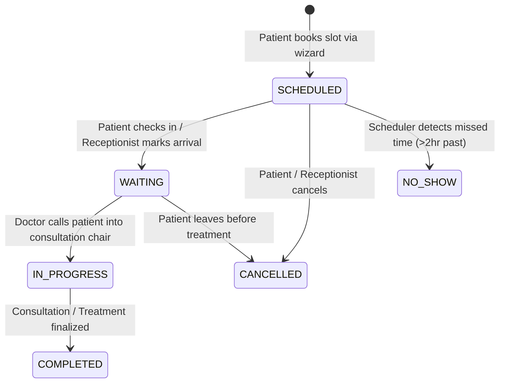
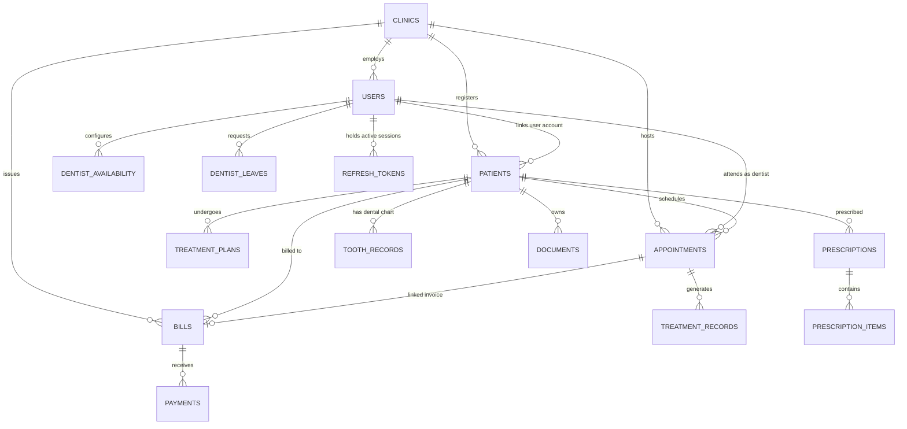
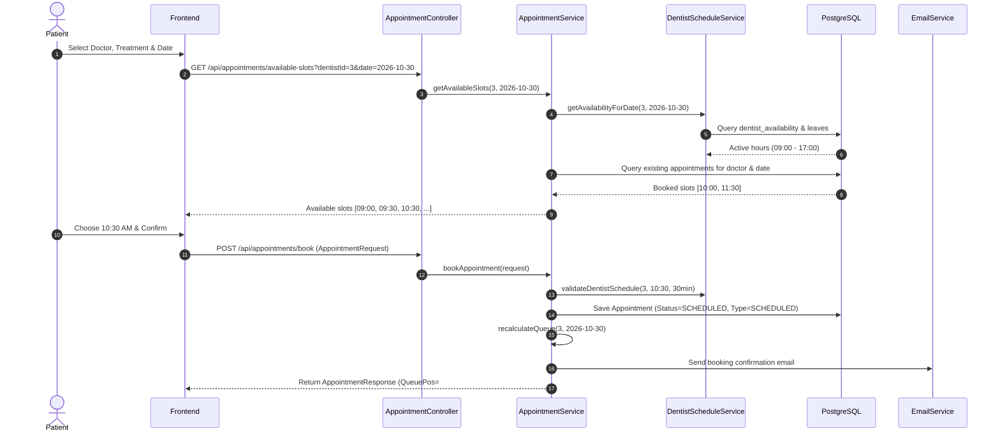
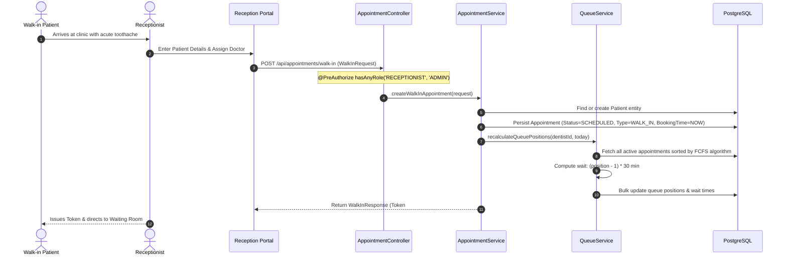
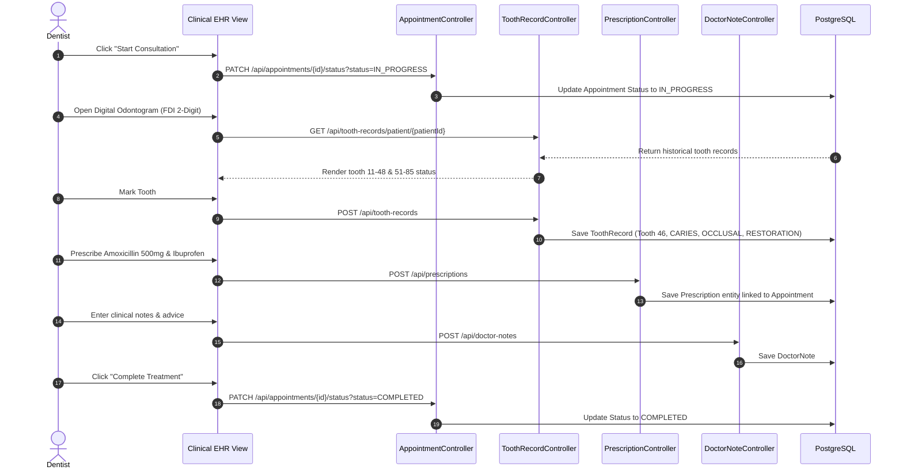
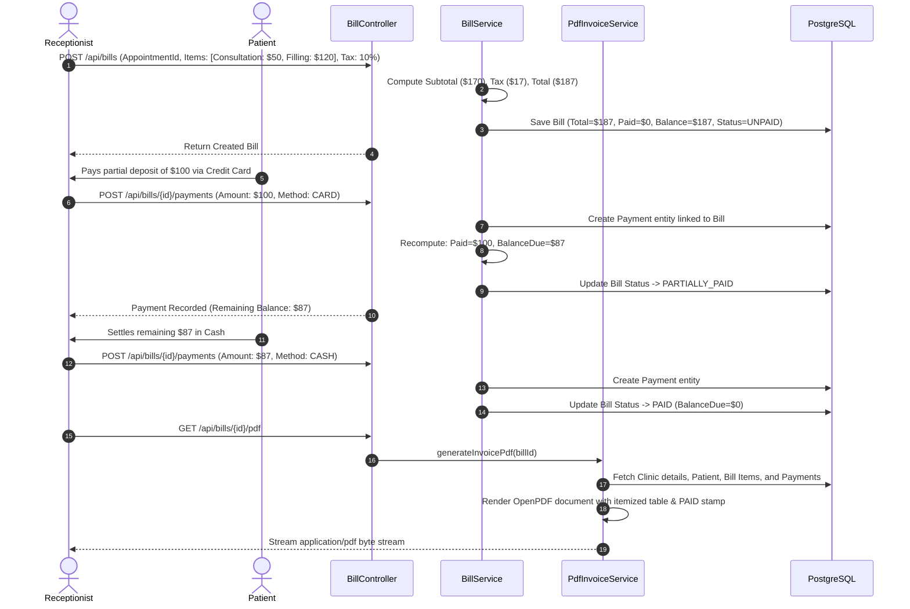
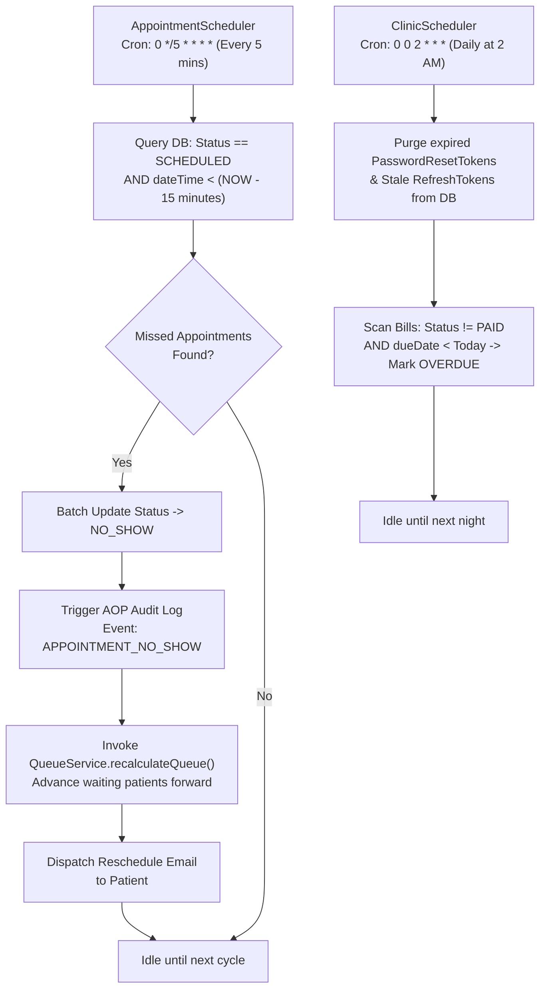
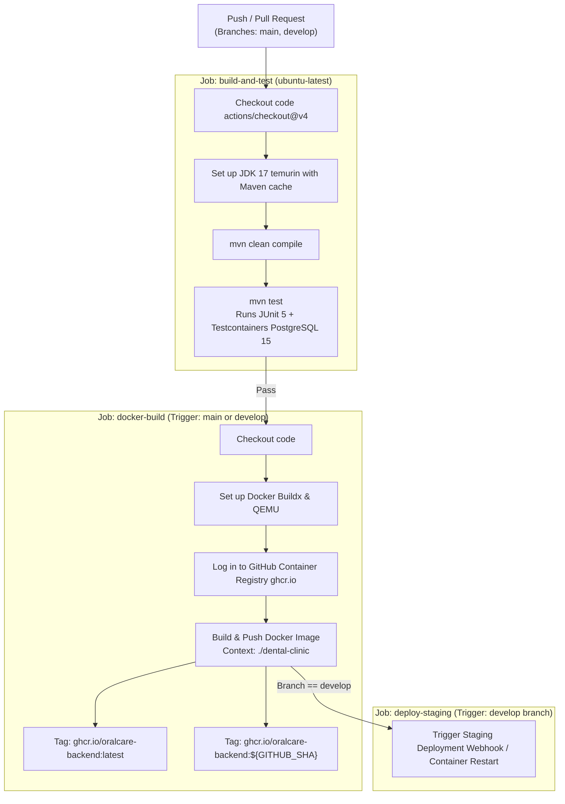

# 🦷 OralCare Dental Clinic Management & Clinical SaaS Platform

[](https://spring.io/projects/spring-boot)
[](https://www.oracle.com/java/)
[](https://www.postgresql.org/)
[](https://redis.io/)
[](https://flywaydb.org/)
[](https://www.docker.com/)
[](LICENSE)

An enterprise-grade, multi-tenant clinical healthcare backend built with **Spring Boot 3.2.4**, **PostgreSQL**, **Redis**, and **Spring Security 6**. Designed to streamline high-throughput dental practice management, automated queue scheduling, odontogram tooth charting, multi-tier billing, automated no-show detection, audit logging, and role-based access control.

---

## 📋 Table of Contents

- [1. Executive Summary & Problem Statement](#1-executive-summary--problem-statement)
- [2. System Architecture & Request Lifecycle](#2-system-architecture--request-lifecycle)
- [3. Technology Stack & Design Decisions](#3-technology-stack--design-decisions)
- [4. Core Modules & Business Logic](#4-core-modules--business-logic)
  - [4.1 Authentication, Identity & Session Management](#41-authentication-identity--session-management)
  - [4.2 Appointment Lifecycle & FCFS Queue Engine](#42-appointment-lifecycle--fcfs-queue-engine)
  - [4.3 Doctor Availability & Consultation Window Enforcement](#43-doctor-availability--consultation-window-enforcement)
  - [4.4 Automated No-Show Detection & Background Schedulers](#44-automated-no-show-detection--background-schedulers)
  - [4.5 Walk-in Triage Workflow & Receptionist RBAC](#45-walk-in-triage-workflow--receptionist-rbac)
  - [4.6 Odontogram & Digital Dental Charting](#46-odontogram--digital-dental-charting)
  - [4.7 Multi-Tier Billing, Invoicing & Payments](#47-multi-tier-billing-invoicing--payments)
  - [4.8 Enterprise AOP Audit Trail](#48-enterprise-aop-audit-trail)
  - [4.9 Document Management & Clinical Reports](#49-document-management--clinical-reports)
  - [4.10 Unified Patient Clinical Timeline](#410-unified-patient-clinical-timeline)
- [5. Database Architecture & Persistence Strategy](#5-database-architecture--persistence-strategy)
- [6. End-to-End Application Workflows](#6-end-to-end-application-workflows)
  - [6.1 Scheduled Patient Booking & Dynamic Slot Validation](#61-scheduled-patient-booking--dynamic-slot-validation)
  - [6.2 Receptionist Walk-in Triage & FCFS Priority Queue](#62-receptionist-walk-in-triage--fcfs-priority-queue)
  - [6.3 Clinical Consultation, FDI Odontogram & Prescriptions](#63-clinical-consultation-fdi-odontogram--prescriptions)
  - [6.4 Multi-Tier Billing, Partial Payments & Invoicing](#64-multi-tier-billing-partial-payments--invoicing)
  - [6.5 Automated No-Show Detection & Background Cleanup](#65-automated-no-show-detection--background-cleanup)
- [7. Complete REST API Reference](#7-complete-rest-api-reference)
- [8. Security Architecture](#8-security-architecture)
- [9. Performance & Caching Strategy](#9-performance--caching-strategy)
- [10. External Integrations & Scheduled Jobs](#10-external-integrations--scheduled-jobs)
- [11. Configuration & Environment Variables](#11-configuration--environment-variables)
- [12. Local Setup, Docker & CI/CD Deployment](#12-local-setup-docker--cicd-deployment)
  - [12.1 Running via Docker Compose](#121-running-via-docker-compose-recommended)
  - [12.2 Running Bare-Metal / Local Development](#122-running-bare-metal--local-development)
  - [12.3 GitHub Actions CI/CD Pipeline & Automated Delivery](#123-github-actions-cicd-pipeline--automated-delivery)
- [13. Testing Strategy & Testcontainers Verification](#13-testing-strategy--testcontainers-verification)
- [14. Error Handling, Reliability & Health Probes](#14-error-handling-reliability--health-probes)
- [15. Known Limitations & Roadmap](#15-known-limitations--roadmap)
- [16. License](#16-license)

---

## 1. Executive Summary & Problem Statement

### The Problem
Traditional dental practices face recurring operational bottlenecks:
1. **Queue Stalls & Waiting Room Congestion:** Scheduling without intelligent slot generation leads to double-booking and erratic wait times.
2. **High No-Show Rates:** Missed appointments waste valuable practitioner hours without automated penalty or rescheduling pipelines.
3. **Complex Dental Records:** General-purpose EHR systems lack FDI-compliant tooth charting (odontograms) for accurate cavity, crown, and root-canal tracking.
4. **Billing Leakage:** Multi-stage dental treatments (e.g., implants, orthodontic adjustments) often fail to bridge initial deposits, milestone payments, and overdue insurance adjustments.
5. **Multi-Tenancy & Data Scoping:** Expanding across branch locations requires strict tenant isolation without maintaining duplicate infrastructures.

### The Solution
**OralCare** provides an API-first clinical management engine that synchronizes appointment scheduling with real-time doctor availability, operates a First-Come-First-Served (FCFS) queue with dynamically computed wait times, auto-detects missed appointments via background schedulers, enforces FDI odontogram tracking, generates automated PDF invoices with partial payment support, and audits critical medical actions via Spring AOP.

---

## 2. System Architecture & Request Lifecycle

The application adheres to clean architecture principles with strict boundary separation across controllers, domain services, persistence layers, and cross-cutting security aspects.

### 2.1 Architectural Flow Diagram

```mermaid
flowchart TD
    Client([Web Frontend / Mobile Client])
    
    subgraph Spring Boot 3 Application Layer
        ContextPath["/api (Servlet Context Root)"]
        
        subgraph SecurityFilter Pipeline
            CORS[CORS Filter]
            RateLimiter[Bucket4j Rate Limiting Filter<br/>10 req/min for /auth]
            JWTFilter[JwtAuthenticationFilter<br/>Bearer Token Validation]
            SecurityContext[SecurityContextHolder<br/>Role-Based Authorities]
        end
        
        subgraph Cross-Cutting Concerns
            AOPAspect[AuditAspect @AfterReturning<br/>Enterprise Event Logging]
            GlobalHandler[GlobalExceptionHandler<br/>Standard ApiResponse Envelope]
        end
        
        subgraph Controller Layer
            AuthCtrl[AuthController]
            AptCtrl[AppointmentController]
            DentistCtrl[DentistScheduleController]
            BillCtrl[BillController]
            PatientCtrl[PatientController]
            OdontoCtrl[ToothRecordController]
            AdminCtrl[AdminController]
        end
        
        subgraph Service Layer
            AuthSvc[AuthService / RefreshTokenService]
            AptSvc[AppointmentService]
            ScheduleSvc[DentistScheduleService]
            BillSvc[BillService / PdfInvoiceService]
            PatientSvc[PatientService]
            OdontoSvc[ToothRecordService]
            QueueSvc[QueueService]
        end
        
        subgraph Persistence Layer
            SpringDataJPA[Spring Data JPA Repositories]
            HikariCP[Hikari Connection Pool]
        end
        
        subgraph Background Schedulers
            AptScheduler[AppointmentScheduler<br/>Cron: 0 */5 * * * *]
            ClinicScheduler[ClinicScheduler<br/>Hourly Reminders, Overdue Invoices]
        end
    end
    
    subgraph Infrastructure
        Postgres[(PostgreSQL 15<br/>Flyway V1 - V6)]
        Redis[(Redis 7 Cache<br/>Dashboard / Analytics)]
        SMTP[Spring Mail / SMTP<br/>OTP & Reminders]
        Storage[Local File Storage / Uploads<br/>PDFs & Clinical Reports]
    end
    
    Client --> ContextPath
    ContextPath --> CORS
    CORS --> RateLimiter
    RateLimiter --> JWTFilter
    JWTFilter --> SecurityContext
    SecurityContext --> Controller Layer
    
    Controller Layer --> Service Layer
    Service Layer -.-> AOPAspect
    Service Layer --> SpringDataJPA
    SpringDataJPA --> HikariCP
    HikariCP --> Postgres
    
    Service Layer <--> Redis
    Service Layer --> SMTP
    Service Layer --> Storage
    
    AptScheduler --> Postgres
    ClinicScheduler --> Postgres
    ClinicScheduler --> SMTP
```

### 2.2 Request-Response Lifecycle
1. **Entry & Context Resolution:** Requests hit `http://localhost:8080/api`. The servlet context root `/api` delegates to the `DispatcherServlet`.
2. **Security & Pre-Filtering:**
   - `CORSFilter` validates origin headers against the white-listed client URLs.
   - `RateLimitingFilter` checks the client IP against a Bucket4j token bucket (10 requests/minute limit on authentication endpoints).
   - `JwtAuthenticationFilter` inspects the `Authorization: Bearer <token>` header, parses claims via `JwtUtil`, extracts the user identifier and permissions, and populates `SecurityContextHolder`.
3. **Controller Mapping:** `VersionRequestMappingHandlerMapping` matches the URI and HTTP verb to the appropriate controller method. `@PreAuthorize` guards verify the required roles (`ADMIN`, `DENTIST`, `RECEPTIONIST`, `PATIENT`).
4. **Validation:** `@Valid` triggers Jakarta Bean Validation against incoming DTOs. Violations are immediately intercepted by `GlobalExceptionHandler`, yielding a structured `400 Bad Request` with per-field errors.
5. **Business Logic Execution:** Domain services orchestrate transactions under `@Transactional`, query/update persistence repositories, and evict stale Redis cache keys when write operations occur.
6. **Cross-Cutting Audit Logging:** Methods annotated with `@Audit` trigger `AuditAspect` upon successful execution, saving immutable audit log records (action, user ID, IP address, payload hash) to `audit_logs`.
7. **Unified Response Formatting:** Successful responses are wrapped in `ApiResponse<T>.success(...)` returning HTTP 200/201. Failures map to specific status codes (401, 403, 404, 409, 429, 500).

---

## 3. Technology Stack & Design Decisions

| Category | Technology | Rationale & Architectural Trade-off |
|---|---|---|
| **Core Framework** | Spring Boot 3.2.4 (Java 17) | Modern LTS platform offering modular Jakarta EE namespaces, native virtual thread readiness, and hardened auto-configuration. |
| **Security** | Spring Security 6 + jjwt 0.11.5 | Stateless session architecture using HMAC-SHA256 tokens with rotating refresh tokens stored in database for multi-device support. |
| **Rate Limiter** | Bucket4j 8.7.0 | In-memory token-bucket algorithm preventing brute-force credential stuffing and OTP spamming on authentication paths. |
| **Database** | PostgreSQL 15 | Strict ACID guarantees, JSONB support, row-level locking capabilities, and high-frequency indexing for relational clinical schemas. |
| **Schema Migration** | Flyway 9.x | Version-controlled, reproducible SQL migrations from initial schema creation (`V1`) through odontograms (`V5`) and appointment types (`V6`). |
| **ORM / Data Access** | Spring Data JPA / Hibernate 6 | Rich declarative repository abstraction, transactional boundaries, and JPQL projection queries for optimized joins. |
| **Caching** | Redis 7 (`spring-boot-starter-data-redis`) | High-speed cache layer for computationally heavy analytics dashboards, reducing query load on relational tables. |
| **Document Generation** | OpenPDF 1.3.30 + Apache POI 5.2.5 | Native on-the-fly PDF invoice generation (OpenPDF) and multi-sheet workbook generation for revenue/appointment audits (Apache POI). |
| **Testing** | JUnit 5, Mockito, Testcontainers 1.20.1 | Testcontainers runs isolated, disposable PostgreSQL instances inside Docker during integration tests, guaranteeing parity with production. |
| **API Documentation** | Springdoc OpenAPI 2.3.0 | Auto-generated OpenAPI 3.0 specification exposed through an interactive Swagger UI at `/swagger-ui.html`. |
| **Monitoring** | Micrometer + Prometheus Actuator | Native metric collection (`/actuator/prometheus`) tracking appointment booking counters, authentication failures, and JVM health. |

---

## 4. Core Modules & Business Logic

### 4.1 Authentication, Identity & Session Management
- **Stateless JWT Architecture:** Tokens carry subject (email), `userId`, `clinicId`, and roles. Access tokens expire in 24 hours (`86400000ms`); refresh tokens expire in 7 days (`604800000ms`).
- **Account Lockout Protection:** The system monitors consecutive failed authentication attempts in `users.failed_login_attempts`. Upon 5 consecutive failures, the account is locked for 15 minutes (`locked_until = now() + 15 min`).
- **Multi-Device Refresh Token Rotation:** Unlike naive single-token implementations, `refresh_tokens` supports concurrent logins from multiple devices by tracking `ip_address`, `device_details`, and `last_active` per session.
- **Email Verification & OTP Flow:** New patient registrations are created in an unverified state (`is_active = false`, `is_email_verified = false`). A 6-digit numeric OTP is dispatched via SMTP and must be validated against `otp_verifications` within a 5-minute window before the account activates.
- **Google OAuth2 Federation:** `CustomOAuth2UserService` intercepts Google SSO responses, provisioning or syncing user accounts and issuing JWT pairs via `OAuth2SuccessHandler`.

### 4.2 Appointment Lifecycle & FCFS Queue Engine
- **First-Come-First-Served (FCFS) Priority:** While slots represent targeted consultation times, queue priority is determined strictly by `booking_time ASC` for all active appointments on a given day.
- **Estimated Wait Calculation:** When an appointment is booked or rescheduled, `recalculateQueue()` dynamically computes each patient's position and estimated wait time:
  $$\text{Estimated Wait} = (\text{Queue Position} - 1) \times \text{Average Consultation Minutes (30)}$$
- **Slot Overlap Validation:** Prevents scheduling collisions by querying active bookings within the requested timeframe. Cancelled and No-Show appointments are excluded from collision checks.
- **Dynamic Consultation Slot Generator:** The backend dynamically checks the practitioner's active weekly schedule (`dentist_availability`) and leaves (`dentist_leaves`). Only time windows within configured start and end hours are partitioned into 30-minute booking slots.



### 4.3 Doctor Availability & Consultation Window Enforcement
- **Weekly Schedule Customization:** Practitioners configure their availability day-by-day (1 = Monday through 7 = Sunday) with distinct start and end times.
- **Pre-Booking Enforcement:** During slot generation and booking validation, `DentistScheduleService.validateDentistSchedule()` enforces:
  1. The practitioner works on the requested day of the week.
  2. The booking start time and estimated end time fall strictly within the practitioner's working window.
  3. The practitioner does not have an approved leave on that calendar date.
- **Dynamic Slot Output:** If a doctor consults from `10:00` to `14:00`, the slot generator strictly yields `10:00, 10:30, 11:00, 11:30, 12:00, 12:30, 13:00, 13:30`, skipping any slot already reserved.

### 4.4 Automated No-Show Detection & Background Schedulers
- **AppointmentScheduler (`0 */5 * * * *`):**
  Runs every 5 minutes and on application startup. Scans for appointments in `SCHEDULED` or `CONFIRMED` status where `date_time` has elapsed.
  - Automatically transitions the record to `NO_SHOW`.
  - Clears the patient's queue position and estimated wait minutes.
  - Notifies the patient and clinic staff via in-app notifications and logs a system audit record.
  - Re-triggers queue recalculation so remaining waiting patients receive reduced wait times.
- **ClinicScheduler (`0 0 * * * *`):**
  - **24-Hour Reminders:** Scans appointments occurring in the 23–25 hour window and dispatches email and in-app reminders.
  - **Overdue Invoices (`0 0 0 * * *`):** Flags `UNPAID` bills whose `due_date < now()` as `OVERDUE` and alerts the patient.
  - **Token Housekeeping (`0 0 2 * * *`):** Purges expired password reset tokens from the database.
  - **6-Month Routine Checkup Recalls (`0 0 9 * * MON`):** Alerts patients who completed treatments 6 months ago to schedule a follow-up hygiene visit.

### 4.5 Walk-in Triage Workflow & Receptionist RBAC
- **Strict Role Enforcement:** Walk-in appointments bypass standard calendar wizard booking and are strictly restricted to `RECEPTIONIST` and `ADMIN` roles.
- **Instant Queue Integration:** Walk-in bookings are assigned `appointment_type = WALK_IN` and automatically set to `WAITING` status with `check_in_time = now()`, immediately inserting the patient into the active live queue.

### 4.6 Odontogram & Digital Dental Charting
- **FDI Two-Digit Dental Numbering:** Manages permanent teeth across all four quadrants (11–18, 21–28, 31–38, 41–48).
- **Clinical Conditions:** Records specific tooth-level conditions (`HEALTHY`, `CAVITY`, `CROWN`, `FILLING`, `EXTRACTED`, `IMPLANT`, `ROOT_CANAL`, `VENEER`, `FRACTURED`).
- **Audit Tracking:** Every update to a patient's odontogram tracks the modifying dentist's identifier (`updated_by`) and timestamp, creating an auditable timeline of dental interventions.

### 4.7 Multi-Tier Billing, Invoicing & Payments
- **Advanced Billing Architecture:** Supports subtotal calculations, tax percentages, discount deductions, and computed totals.
- **Partial & Milestone Payments:** Supports multiple partial payments per invoice via the `payments` table.
- **Automated Payment Status Reconciliation:**
  $$\text{Total Paid} = \sum \text{Payment Amounts}$$
  - $\text{Total Paid} = 0 \implies \text{Status: UNPAID}$
  - $0 < \text{Total Paid} < \text{Total Amount} \implies \text{Status: PARTIALLY\_PAID}$
  - $\text{Total Paid} \ge \text{Total Amount} \implies \text{Status: PAID}$
- **Dynamic PDF Invoices:** Generates branded, tabular PDF statements on demand via `PdfInvoiceService` using OpenPDF.

### 4.8 Enterprise AOP Audit Trail
- **Declarative Auditing:** Critical service methods are annotated with `@Audit(action = "...", entityType = "...")`.
- **Non-Invasive Interception:** `AuditAspect` runs via `@AfterReturning`, capturing user context, client IP, target entity ID, and input parameter digests without polluting core business methods. Failures in audit logging fail safely without rolling back the primary transaction.

### 4.9 Document Management & Clinical Reports
- **Multipart Upload Processing:** Accepts diagnostic images, lab results, and x-ray files up to 10MB (`spring.servlet.multipart.max-file-size: 10MB`).
- **Path Sanitization & Secure Storage:** Validates MIME types, sanitizes uploaded filenames to prevent directory traversal attacks, and stores files in a configured directory (`FILE_UPLOAD_DIR`).

### 4.10 Unified Patient Clinical Timeline
- **Aggregated Medical History:** `TimelineService` compiles patient data from multiple tables (appointments, clinical notes, treatment records, prescriptions, and billing receipts) into a single, chronologically sorted timeline.

---

## 5. Database Architecture & Persistence Strategy

The application uses PostgreSQL 15 managed with Flyway migrations (`src/main/resources/db/migration`).

### 5.1 Entity Relationship Diagram



### 5.2 Migration History

| Version | Migration File | Scope & Impact |
|---|---|---|
| **V1** | `V1__init_schema.sql` | Core schema: `clinics`, `users`, `patients`, `appointments`, `treatment_plans`, `reports`, `notifications`, `bills`, `prescriptions`, `doctor_notes`, `password_reset_tokens`. |
| **V2** | `V2__enhance_features.sql` | Added `treatment_records`, `prescription_items`, `dentist_availability`, `dentist_leaves`, `login_history`, reminder flags. |
| **V3** | `V3__saas_upgrade.sql` | Multi-device session support on `refresh_tokens`, tenant isolation foreign keys (`clinic_id`) across bills, prescriptions, treatment plans. |
| **V4** | `V4__advanced_billing.sql` | Added `payments` ledger table with indices for partial payments, transaction references, and refund tracking. |
| **V5** | `V5__odontogram.sql` | Added `tooth_records` table with unique constraint `(patient_id, tooth_number)` and index for fast FDI tooth state queries. |
| **V6** | `V6__add_appointment_type.sql` | Added `appointment_type` (`SCHEDULED`, `WALK_IN`) with default backfill and `NOT NULL` constraint. |

### 5.3 High-Frequency Indices

To prevent table scans under concurrent multi-tenant loads:
- `idx_apt_booking` ON `appointments(booking_time)` — Optimizes FCFS priority queries.
- `idx_apt_datetime` ON `appointments(date_time)` — Accelerates slot conflict detection.
- `idx_apt_dentist` ON `appointments(dentist_id)` — Speeds up calendar views.
- `idx_payment_bill` ON `payments(bill_id)` — Optimizes invoice balance calculations.
- `idx_tooth_patient` ON `tooth_records(patient_id)` — Speeds up odontogram rendering.
- `idx_rt_user` ON `refresh_tokens(user_id)` — Enables fast multi-device session resolution.

---

## 6. End-to-End Application Workflows

### 6.1 Scheduled Patient Booking & Dynamic Slot Validation

This workflow ensures zero double-booking and validates patient booking requests strictly against doctor working hours and leave intervals.



1. **Slot Inspection:** Client invokes `GET /api/appointments/available-slots`. `DentistScheduleService` resolves active shifts (`09:00-17:00`) and subtracts scheduled leaves. If off-duty, an empty array `[]` is returned immediately.
2. **Conflict Checking:** Upon `POST /api/appointments/book`, `AppointmentService` performs `@Transactional` validation ensuring no simultaneous appointment exists and the requested time falls within configured working hours.
3. **Queue Ingestion:** The appointment is assigned status `SCHEDULED` and `appointment_type = SCHEDULED`. The dynamic queue engine recalculates queue positions for all active patients of that doctor for that calendar day.
4. **Notification:** An asynchronous confirmation email is triggered via `EmailService`.

---

### 6.2 Receptionist Walk-in Triage & FCFS Priority Queue

For unscheduled patients arriving directly at the clinic front desk, this workflow bypasses standard pre-booking while preserving queue fairness and slot integrity.



1. **Authorization Guard:** Endpoint `POST /api/appointments/walk-in` strictly requires `ROLE_RECEPTIONIST` or `ROLE_ADMIN`.
2. **Entity Creation:** The service locates an existing patient by phone/email or creates a new `Patient` profile on the fly.
3. **Queue Sorting:** Walk-in appointments receive `appointment_type = WALK_IN` and `booking_time = Instant.now()`.
4. **FCFS Rebalance:** `QueueService` re-computes order using the formula:
   $$\text{Estimated Wait Time} = (\text{Queue Position} - 1) \times 30 \text{ minutes}$$
5. **Live Queue Board:** The patient is issued an instant token and appears on the waiting room monitor.

---

### 6.3 Clinical Consultation, FDI Odontogram & Prescriptions

This workflow guides the dentist through physical examination, digital tooth charting, diagnosis, and medication issuance.



1. **Status Transition:** The doctor changes appointment status to `IN_PROGRESS`, locking the slot on the waiting room board.
2. **Odontogram Inspection:** The digital dental chart visualizes FDI 2-digit numbered adult teeth (11–48) and pediatric teeth (51–85).
3. **Surface-Level Diagnosis:** Doctor records specific surface defects (`OCCLUSAL`, `MESIAL`, `DISTAL`, `BUCCAL`, `LINGUAL`) and treatment recommendations (`CROWN`, `FILLING`, `EXTRACTION`, `ROOT_CANAL`).
4. **Clinical Documentation:** Electronic prescriptions (`Prescription`) and physician diagnosis entries (`DoctorNote`) are immutably tied to the appointment and patient history.
5. **Session Wrap-up:** Appointment transitions to `COMPLETED`, signaling the billing desk.

---

### 6.4 Multi-Tier Billing, Partial Payments & Invoicing

Handles multi-stage dental financial lifecycles, enabling itemized charging, partial down-payments, ledger reconciliations, and dynamic PDF invoice generation.



1. **Invoice Generation:** `BillService` calculates itemized totals, clinic tax percentages, and balance due, initializing status as `UNPAID`.
2. **Partial Payments:** `POST /api/bills/{id}/payments` allows incremental deposits (common for multi-visit treatments like orthodontics or implants). Balance due is decremented atomically; if balance reaches 0, status transitions to `PAID`, otherwise `PARTIALLY_PAID`.
3. **OpenPDF Streaming:** `GET /api/bills/{id}/pdf` produces a branded vector PDF receipt detailing line items, payment audit timestamps, tax calculations, and payment status stamps without requiring external PDF rendering engines.

---

### 6.5 Automated No-Show Detection & Background Cleanup

Autonomous background cron schedulers prevent queue stalling and maintain database hygiene without manual administrative intervention.



1. **5-Minute No-Show Detection:** `AppointmentScheduler` inspects all pending appointments. If a patient is more than 15 minutes late without checking in, the appointment transitions to `NO_SHOW`.
2. **Queue Shaving:** When an appointment is flagged as `NO_SHOW`, `recalculateQueue()` is triggered immediately, shaving estimated wait times for downstream waiting patients and opening the slot for immediate walk-ins.
3. **Overdue Invoicing & Session Housekeeping:** `ClinicScheduler` sweeps overdue bills every morning and purges stale database tokens every night at 02:00 AM.

---

## 7. Complete REST API Reference

All endpoints are hosted under servlet context path `/api`. Endpoints require JWT Bearer authentication unless marked **Public**.

### 7.1 Authentication & Session Management (`/api/auth`, `/api/sessions`)

| Verb | Path | Auth / Role | Description |
|---|---|---|---|
| `POST` | `/auth/login` | Public | Authenticates credentials; returns JWT pair and user profile. |
| `POST` | `/auth/register` | Public | Registers a new user. Default role is `PATIENT`. Dispatches OTP. |
| `POST` | `/auth/send-registration-otp` | Public | Resends account activation OTP to user email. |
| `POST` | `/auth/verify-registration-otp` | Public | Validates OTP and activates user account. |
| `POST` | `/auth/forgot-password` | Public | Generates password reset token and dispatches email link. |
| `POST` | `/auth/reset-password` | Public | Consumes reset token and applies new BCrypt password hash. |
| `POST` | `/auth/refresh-token` | Public | Exchanges valid refresh token for a fresh JWT access token. |
| `GET` | `/sessions/active` | Authenticated | Lists all active device sessions for authenticated user. |
| `DELETE` | `/sessions/{id}` | Authenticated | Revokes a specific device session / refresh token. |

#### Example: Login Request & Response
```http
POST /api/auth/login HTTP/1.1
Content-Type: application/json

{
  "email": "patient1@oralcare.com",
  "password": "your-password"
}
```
```json
{
  "success": true,
  "message": "Login successful",
  "data": {
    "accessToken": "eyJhbGciOiJIUzI1NiJ9...",
    "refreshToken": "4d7c92b1-6a23-4e89-a291-...",
    "tokenType": "Bearer",
    "expiresIn": 86400000,
    "user": {
      "id": 5,
      "name": "Alice Johnson",
      "email": "patient1@oralcare.com",
      "role": "PATIENT",
      "active": true
    }
  }
}
```

---

### 7.2 Appointments & Queue Engine (`/api/appointments`, `/api/queue`)

| Verb | Path | Roles | Description |
|---|---|---|---|
| `GET` | `/appointments` | ADMIN, DENTIST, RECEPTIONIST | Retrieves all appointments with optional status filtering. |
| `GET` | `/appointments/{id}` | All Roles | Retrieves full appointment details by ID. |
| `GET` | `/appointments/available-slots` | All Roles | Computes available 30-min slots for doctor and date. |
| `GET` | `/appointments/patient/{patientId}` | All Roles | Retrieves appointment history for specific patient. |
| `GET` | `/appointments/dentist/{dentistId}` | All Roles | Retrieves schedule for specific practitioner. |
| `GET` | `/appointments/dentist/{dentistId}/queue` | All Roles | Returns active live queue sorted by FCFS priority. |
| `POST` | `/appointments/book` | ADMIN, RECEPTIONIST, PATIENT, DENTIST | Books standard consultation with FCFS queue assignment. |
| `POST` | `/appointments/walk-in` | ADMIN, RECEPTIONIST | Books walk-in appointment; sets `WAITING` status immediately. |
| `PATCH` | `/appointments/{id}/status` | ADMIN, DENTIST, RECEPTIONIST | Updates status (`WAITING`, `IN_PROGRESS`, `COMPLETED`, etc.). |
| `DELETE` | `/appointments/{id}` | ADMIN | Deletes appointment and recalculates remaining queue. |
| `GET` | `/api/queue/dentist/{dentistId}` | All Roles | Live queue view with estimated wait minutes. |

---

### 7.3 Doctor Availability & Schedules (`/api/dentists`)

| Verb | Path | Roles | Description |
|---|---|---|---|
| `POST` | `/dentists/availability` | ADMIN, DENTIST | Sets or updates operating hours for a specific weekday. |
| `GET` | `/dentists/availability/{dentistId}` | All Roles | Retrieves configured weekly schedule for doctor. |
| `DELETE` | `/dentists/availability/{id}` | ADMIN, DENTIST | Deletes schedule for a weekday (marks day off). |
| `POST` | `/dentists/leaves` | ADMIN, DENTIST | Submits practitioner leave request (`PENDING`). |
| `GET` | `/dentists/leaves/{dentistId}` | ADMIN, DENTIST, RECEPTIONIST | Lists practitioner leave requests and statuses. |
| `POST` | `/dentists/leaves/{id}/approve` | ADMIN, RECEPTIONIST | Approves or rejects practitioner leave (`APPROVED`/`REJECTED`). |

---

### 7.4 Patients & Medical Records (`/api/patients`, `/api/timeline`, `/api/odontogram`)

| Verb | Path | Roles | Description |
|---|---|---|---|
| `GET` | `/patients` | ADMIN, DENTIST, RECEPTIONIST | Lists all registered patients (dentists see own patients). |
| `GET` | `/patients/{id}` | All Roles | Retrieves patient profile by ID. |
| `GET` | `/patients/user/{userId}` | PATIENT | Retrieves or auto-provisions patient profile for authenticated user. |
| `GET` | `/patients/search?name=` | ADMIN, DENTIST, RECEPTIONIST | Case-insensitive patient name search. |
| `POST` | `/patients` | ADMIN, RECEPTIONIST | Creates a patient profile manually. |
| `PUT` | `/patients/{id}` | ADMIN, RECEPTIONIST, DENTIST | Updates patient medical history, allergies, or contact. |
| `GET` | `/api/timeline/patient/{patientId}` | All Roles | Returns unified chronological medical and billing timeline. |
| `GET` | `/odontogram/patient/{patientId}` | All Roles | Retrieves FDI tooth records (11–48) for patient. |
| `PUT` | `/odontogram/patient/{patientId}/tooth/{toothNumber}` | ADMIN, DENTIST | Updates clinical condition and notes for specific tooth. |

---

### 7.5 Billing, Payments & Invoices (`/api/bills`)

| Verb | Path | Roles | Description |
|---|---|---|---|
| `GET` | `/bills` | ADMIN, RECEPTIONIST | Retrieves all clinic bills and payment statuses. |
| `GET` | `/bills/{id}` | ADMIN, RECEPTIONIST, PATIENT | Retrieves specific invoice with payment breakdown. |
| `GET` | `/bills/patient/{patientId}` | ADMIN, RECEPTIONIST, PATIENT | Lists invoices issued to patient. |
| `POST` | `/bills` | ADMIN, RECEPTIONIST | Generates a new invoice with subtotal, tax, and discount. |
| `POST` | `/bills/{id}/payments` | ADMIN, RECEPTIONIST | Records partial or full payment against bill. |
| `GET` | `/bills/{id}/pdf` | All Roles | Streams dynamically generated PDF tax invoice. |

---

### 7.6 Analytics, Exports & Administration (`/api/analytics`, `/api/exports`, `/api/admin`)

| Verb | Path | Roles | Description |
|---|---|---|---|
| `GET` | `/dashboard/stats` | ADMIN, DENTIST, RECEPTIONIST | Returns KPI dashboard metrics (cached in Redis). |
| `GET` | `/analytics/revenue/monthly` | ADMIN | Monthly gross revenue and collection analytics. |
| `GET` | `/analytics/appointments/daily` | ADMIN, DENTIST | Daily booking volume and traffic trends. |
| `GET` | `/exports/appointments/excel` | ADMIN, RECEPTIONIST | Exports appointment records as an Excel workbook (`.xlsx`). |
| `GET` | `/exports/revenue/csv` | ADMIN | Exports revenue and transaction ledger as `.csv`. |
| `GET` | `/admin/audit-logs` | ADMIN | Paginated audit log search by user, action, or date. |
| `DELETE` | `/admin/users/{id}` | ADMIN | Deactivates or permanently removes user account. |

---

## 8. Security Architecture

```mermaid
flowchart LR
    A[Incoming Request] --> B[Bucket4j RateLimitingFilter]
    B -->|Passed| C[JwtAuthenticationFilter]
    B -->|Exceeded Rate Limit| E[HTTP 429 Too Many Requests]
    C -->|Valid Token| D[SecurityContextHolder]
    C -->|Missing / Expired| F[Anonymous Context / 401]
    D --> G[@PreAuthorize RBAC Evaluation]
    G -->|Authorized| H[Controller Action]
    G -->|Forbidden| I[HTTP 403 Forbidden]
```

1. **Password Encryption:** Passwords are hashed using Spring Security's `BCryptPasswordEncoder` configured with work factor `12`.
2. **Rate Limiting:** Protects `/auth/login` and `/auth/register` endpoints using `Bucket4j` (maximum 10 requests per minute per remote IP).
3. **CORS & Hardened Security Headers:**
   - Content Security Policy (CSP): `default-src 'self'; frame-ancestors 'none'; object-src 'none';`
   - Frame Options: `DENY` (prevents clickjacking attacks).
   - XSS Protection: Enabled.
   - Content-Type Sniffing Protection: `nosniff`.
4. **Role-Based Authorization Hierarchy:**
   - `ADMIN`: Unrestricted system access, user management, audit trails, clinic management.
   - `DENTIST`: Clinical workflows, patient records, treatment plans, odontograms, schedule configuration.
   - `RECEPTIONIST`: Patient check-in, walk-in triage, queue management, invoice creation, payment recording.
   - `PATIENT`: Self-service portal, personal appointment booking, profile management, invoice downloading.

---

## 9. Performance & Caching Strategy

1. **Redis Caching (`@Cacheable` & `@CacheEvict`):**
   - High-computation endpoints (e.g., `DashboardService.getStats()`) are cached in Redis under key namespace `dashboard::stats` with a 15-minute TTL.
   - Writes that alter clinic state (`bookAppointment()`, `updateStatus()`, `recordPayment()`) trigger `@CacheEvict(value = "analytics", allEntries = true)` to prevent stale metrics.
2. **JPA N+1 Query Elimination:**
   - Critical repository methods use explicit JPQL `JOIN FETCH` clauses (e.g., `findAllByClinicId` loading bills alongside patient and clinic relations).
3. **Database Connection Management:**
   - HikariCP pool is tuned for clinical concurrency with a maximum pool size of 10 connections, minimum idle of 5, and 20-second connection timeout.

---

## 10. External Integrations & Scheduled Jobs

| Integration | Implementation Class | Configuration / Trigger | Responsibility |
|---|---|---|---|
| **SMTP Mail** | `EmailService.java` | `spring.mail.*` | Dispatches registration OTPs, booking confirmations, and 24h appointment reminders. |
| **No-Show Detection** | `AppointmentScheduler.java` | `@Scheduled(cron = "0 */5 * * * *")` | Auto-transitions expired appointments to `NO_SHOW` and recalculates queue positions. |
| **Bill Reminders** | `ClinicScheduler.java` | `@Scheduled(cron = "0 0 0 * * *")` | Flags unpaid bills past due date as `OVERDUE` and alerts patients. |
| **PDF Invoicing** | `PdfInvoiceService.java` | On-demand via `/bills/{id}/pdf` | Generates clinical PDF invoices with branding, itemized treatments, taxes, and balance dues. |
| **Excel Export** | `ExportService.java` | On-demand via `/exports/**` | Generates Apache POI `.xlsx` workbooks with custom styles for operational auditing. |
| **Prometheus Metrics**| `MetricsService.java` | Micrometer Actuator (`/actuator/prometheus`) | Records application metrics (`appointments.booked.total`, `auth.failures`). |

---

## 11. Configuration & Environment Variables

All configuration keys in `src/main/resources/application.yml` can be overridden via environment variables:

| Variable | Default Value | Description |
|---|---|---|
| `DB_URL` | `jdbc:postgresql://localhost:5432/dental_clinic` | PostgreSQL JDBC connection URL. |
| `DB_USER` | `dental_user` | PostgreSQL database user. |
| `DB_PASS` | `dental_pass` | PostgreSQL database password. |
| `REDIS_HOST` | `localhost` | Redis server hostname. |
| `REDIS_PORT` | `6379` | Redis server port. |
| `JWT_SECRET` | *(256-bit Hex Key)* | Secret key used for signing and validating HMAC-SHA256 tokens. |
| `MAIL_HOST` | `smtp.gmail.com` | SMTP email server hostname. |
| `MAIL_PORT` | `587` | SMTP port (STARTTLS). |
| `MAIL_USER` | `your-email@example.com` | SMTP username / sender address. |
| `MAIL_PASS` | `your-app-password` | SMTP authentication credential. |
| `FILE_UPLOAD_DIR` | `./uploads` | Directory path where patient attachments and reports are stored. |
| `NOTIFICATION_FROM` | `noreply@dentalclinic.com` | Sender address shown in outbound notification emails. |

---

## 12. Local Setup, Docker & CI/CD Deployment

### Prerequisites
- **Docker & Docker Compose** (Recommended for full-stack deployment)
- Alternatively: **Java 17 (JDK)**, **Maven 3.8+**, **PostgreSQL 15**, and **Redis 7**

### 12.1 Running via Docker Compose (Recommended)

The backend includes a multi-stage Docker build and orchestration config in `docker-compose.yml`.

1. **Clone the repository:**
   ```bash
   git clone https://github.com/your-org/dental-clinic.git
   cd dental-clinic
   ```

2. **Start all services:**
   ```bash
   docker compose up --build -d
   ```

3. **Verify running containers:**
   ```bash
   docker ps
   ```
   *Expected services:*
   - `oralcare-api` on port `8080` (Spring Boot API)
   - `oralcare-db` on port `5433 -> 5432` (PostgreSQL)
   - `oralcare-redis` on port `6379` (Redis)

4. **Inspect API health:**
   ```bash
   curl http://localhost:8080/api/actuator/health
   ```
   *Response:* `{"status":"UP","components":{"db":{"status":"UP"},"redis":{"status":"UP"}}}`

---

### 12.2 Running Bare-Metal / Local Development

1. **Start local PostgreSQL and Redis instances:**
   ```sql
   CREATE DATABASE dental_clinic;
   CREATE USER dental_user WITH PASSWORD 'dental_pass';
   GRANT ALL PRIVILEGES ON DATABASE dental_clinic TO dental_user;
   ```

2. **Compile and execute Flyway migrations:**
   ```bash
   mvn clean compile
   ```

3. **Run the Spring Boot application:**
   ```bash
   mvn spring-boot:run
   ```

4. **Access Swagger UI:**
   Open your browser to `http://localhost:8080/api/swagger-ui/index.html`.

---

### 12.3 GitHub Actions CI/CD Pipeline & Automated Delivery

The repository includes a production-grade CI/CD pipeline defined in [`.github/workflows/ci-cd.yml`](file:///.github/workflows/ci-cd.yml) providing continuous integration, automated Testcontainers validation, multi-arch Docker image packaging, and container registry publishing.



#### Pipeline Stages & Quality Gates

| Stage | Trigger Branch | Responsibilities & Tooling | Failure Behavior |
|---|---|---|---|
| **`build-and-test`** | `main`, `develop` (Push & PR) | Compiles Java 17 bytecode, validates Maven dependencies, and runs full unit & integration tests using ephemeral **PostgreSQL 15 Testcontainers**. | Pipeline halts immediately; merges blocked. |
| **`docker-build`** | `main`, `develop` (Push only) | Initializes QEMU and Docker Buildx; builds multi-stage production Docker image; tags with commit SHA and `:latest`; pushes to **GitHub Container Registry (`ghcr.io`)**. | Image is not published; deployment blocked. |
| **`deploy-staging`** | `develop` (Push only) | Triggers automated rollout of the newly tagged GHCR container to the staging test environment. | Alerts team via GitHub Actions log notification. |

#### Security & Secrets Management
- The workflow leverages GitHub's built-in OIDC and `${{ secrets.GITHUB_TOKEN }}` to authenticate against `ghcr.io` without requiring external personal access tokens.
- Ephemeral test containers isolate database tests so that no external database secrets or host configurations are exposed during CI.

---

## 13. Testing Strategy & Testcontainers Verification

The project employs a layered testing strategy combining mock-based unit tests and real-database integration tests via Testcontainers.

### 13.1 Test Architecture
- **`BaseIntegrationTest.java`:** Provides a reusable test harness that starts an ephemeral PostgreSQL container (`postgres:15-alpine`) via Testcontainers. Tests execute against real database tables and constraints rather than in-memory H2 approximations.
- **`SecurityIntegrationTest.java`:** Validates `@PreAuthorize` role isolation across public, patient, dentist, and administrator endpoints.
- **`BillingIntegrationTest.java`:** Verifies invoice lifecycle, tax calculations, and partial payment ledger balance adjustments.
- **`SmartAnalyticsIntegrationTest.java`:** Tests analytics aggregation queries and KPI endpoints.
- **`AppointmentNoShowServiceTest.java`:** Validates background detection and status transitions for missed appointments.
- **`AppointmentQueueManagementTest.java`:** Tests FCFS priority sorting, walk-in queue insertions, and collision checks.

### 13.2 Executing Tests
```bash
# Run unit and integration test suites
mvn test

# Run a specific test class
mvn test -Dtest=AppointmentQueueManagementTest

# Package application while skipping tests
mvn clean package -DskipTests
```

---

## 14. Error Handling, Reliability & Health Probes

### Standard Error Response Format
All errors handled by `GlobalExceptionHandler` return a predictable schema:
```json
{
  "success": false,
  "message": "Resource not found: Patient with ID 99 was not found",
  "data": null
}
```

### Validation Error Format (HTTP 400)
```json
{
  "success": false,
  "message": "Validation failed",
  "data": {
    "dateTime": "Appointment date cannot be in the past. Today's date is allowed.",
    "treatmentType": "must not be blank"
  }
}
```

### HTTP Status Code Mapping

| Status Code | Exception Class | Scenario |
|---|---|---|
| **400 Bad Request** | `BadRequestException`, `MethodArgumentNotValidException` | Input validation failed, booking time in past, invalid parameters. |
| **401 Unauthorized** | `BadCredentialsException`, `TokenException` | Bad password, expired or invalid JWT token. |
| **403 Forbidden** | `AccessDeniedException` | Insufficient role permissions (e.g., patient accessing `/admin`). |
| **404 Not Found** | `ResourceNotFoundException` | Patient, dentist, invoice, or appointment record does not exist. |
| **409 Conflict** | `ConflictException` | Email already registered, duplicate odontogram tooth constraint. |
| **413 Payload Too Large** | `MaxUploadSizeExceededException` | Clinical report file exceeds 10MB limit. |
| **429 Too Many Requests** | `RateLimitingFilter` | IP exceeded 10 login/registration requests in 1 minute. |
| **500 Internal Error** | `Exception` | Unhandled runtime errors (logged with full stack trace). |

---

## 15. Known Limitations & Roadmap

### Current Limitations
1. **SMS Provider Integration:** The notification service logs and formats SMS reminders, but uses an email-first delivery pipeline. A Twilio or AWS SNS client is planned for production cellular alerts.
2. **Distributed Queue Locking:** Queue position recalculation is currently synchronized at the database transaction level; scaling to multiple API replicas will benefit from Redis distributed locks (`Redisson`).

### Roadmap
- [ ] Integration with Twilio / AWS SNS for SMS dispatch.
- [ ] Stripe / Razorpay webhook integration for patient self-service online payments.
- [ ] HL7 / FHIR standard export for enterprise hospital interoperability.
- [ ] WebSocket STOMP real-time updates for live waiting room queue boards.

---

## 16. License

This project is licensed under the MIT License — see the [LICENSE](LICENSE) file for details.
