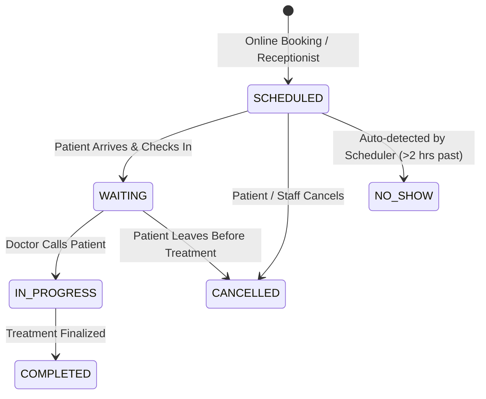
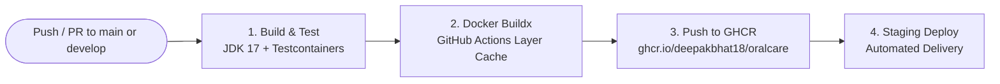

# 🦷 OralCare — Enterprise Multi-Tenant Dental Practice & Clinical SaaS Platform

[](https://spring.io/projects/spring-boot)
[](https://www.oracle.com/java/)
[](https://www.postgresql.org/)
[](https://redis.io/)
[](https://flywaydb.org/)
[](https://www.docker.com/)
[](LICENSE)

An enterprise-grade, multi-tenant clinical healthcare SaaS backend built with **Spring Boot 3.2.4**, **PostgreSQL 15**, **Redis 7**, and **Spring Security 6**. Designed to power high-throughput dental chains with automated queue scheduling, FDI-standard digital tooth charting (odontograms), multi-tier invoice reconciliation, background no-show detection, enterprise AOP auditing, and hardened role-based security.

---

## 📋 Table of Contents

1. [Executive Overview & Business Problems Solved](#1-executive-overview--business-problems-solved)
2. [System Architecture & Request Lifecycle](#2-system-architecture--request-lifecycle)
3. [Technology Stack & Design Choices](#3-technology-stack--design-choices)
4. [Core Modules & Business Logic](#4-core-modules--business-logic)
5. [Quick Start & Local Setup](#5-quick-start--local-setup)
6. [Security Architecture & Secrets Management](#6-security-architecture--secrets-management)
7. [Testing Strategy (Testcontainers)](#7-testing-strategy-testcontainers)
8. [Core API Reference](#8-core-api-reference)
9. [🎯 Interview Preparation & Technical Deep-Dive Guide](#9--interview-preparation--technical-deep-dive-guide)
10. [CI/CD & Deployment](#10-cicd--deployment)

---

## 1. Executive Overview & Business Problems Solved

### The Operational Challenges in Dental Clinics
1. **Waiting Room Congestion & Uneven Queue Times:** Traditional booking causes double-booking, practitioner bottlenecks, and unpredictable walk-in surges.
2. **High No-Show Rates (15–25% Industry Average):** Unattended slots cost practitioners hours of productivity without automated forfeiture or schedule backfilling.
3. **Non-Standardized Dental Records:** Generic EHRs lack graphical tooth-level tracking (FDI two-digit notation), complicating restorative history, cavities, crowns, and periodontal charting.
4. **Billing Leakage in Multi-Stage Procedures:** Treatments (implants, braces, root canals) span multiple sittings; clinics struggle to track partial deposits, balances, and automated PDF invoicing.
5. **Multi-Tenancy & Data Privacy (HIPAA):** Clinic chains require strict tenant isolation (`clinic_id`) without provisioning independent database servers for every branch.

### The OralCare Solution
OralCare provides an API-first clinical management engine:
- **Smart FCFS Queue Engine:** Combines fixed time slots with real-time arrival queues, dynamically updating wait times when consults conclude or patients cancel.
- **Automated Missed-Appointment Schedulers:** A background cron daemon identifies lapsed appointments, transitions them to `NO_SHOW`, notifies patients, and recalibrates queue times for waiting patients.
- **FDI Two-Digit Odontogram Charting:** Full quadrant-based tooth surface tracking (teeth 11–48) recording conditions, treatments, and modifying dentists with full historical audit trails.
- **Multi-Tier Billing & Dynamic PDF Invoices:** Subtotals, configurable tax/discount calculations, partial installment tracking, and automated PDF invoice generation.
- **Enterprise Spring AOP Auditing:** Automatically intercepts clinical and financial actions, writing tamper-evident audit logs (`audit_logs`) without cluttering core service logic.

---

## 2. System Architecture & Request Lifecycle

OralCare follows clean, layered architecture principles with strict separation between Web Controllers, Business Domain Services, Security Filters, and Persistence layers.

### 2.1 Architectural Flow Diagram

```mermaid
flowchart TD
    Client([Web Frontend / Mobile / Swagger UI])
    
    subgraph Spring Boot 3 Application Layer
        ContextRoot["/api (Context Path)"]
        
        subgraph SecurityFilter Pipeline
            CORS[CorsFilter]
            RateLimiter[Bucket4j Rate Limiting Filter<br/>10 req/min on /auth]
            JWTFilter[JwtAuthenticationFilter<br/>Bearer Token Validation]
            SecurityContext[SecurityContextHolder<br/>Authorities & Tenant Context]
        end
        
        subgraph Interceptors & AOP
            AOPAspect[AuditAspect @AfterReturning<br/>Immutable Audit Logging]
            GlobalHandler[GlobalExceptionHandler<br/>Standard ApiResponse Envelope]
        end
        
        subgraph Controllers
            AuthCtrl[AuthController]
            AptCtrl[AppointmentController]
            DentistCtrl[DentistScheduleController]
            BillCtrl[BillController]
            OdontoCtrl[ToothRecordController]
            PatientCtrl[PatientController]
        end
        
        subgraph Domain Services
            AuthSvc[AuthService / RefreshTokenService]
            AptSvc[AppointmentService / QueueService]
            ScheduleSvc[DentistScheduleService]
            BillSvc[BillService / PdfInvoiceService]
            OdontoSvc[ToothRecordService]
        end
        
        subgraph Persistence & Data
            SpringDataJPA[Spring Data JPA Repositories]
            HikariCP[Hikari Connection Pool]
        end
        
        subgraph Background Schedulers
            AptScheduler[AppointmentScheduler<br/>Cron: 0 */5 * * * *]
            ClinicScheduler[ClinicScheduler<br/>Hourly Reminders & Invoices]
        end
    end
    
    subgraph Infrastructure
        Postgres[(PostgreSQL 15<br/>Flyway V1-V6)]
        Redis[(Redis 7 Cache<br/>Dashboard & Session Cache)]
        SMTP[Spring Mail / SMTP<br/>OTP & Reminders]
        Storage[Local File Storage / Uploads<br/>X-Rays & Reports]
    end
    
    Client --> ContextRoot
    ContextRoot --> CORS
    CORS --> RateLimiter
    RateLimiter --> JWTFilter
    JWTFilter --> SecurityContext
    SecurityContext --> Controllers
    
    Controllers --> Domain Services
    Domain Services -.-> AOPAspect
    Domain Services --> SpringDataJPA
    SpringDataJPA --> HikariCP
    HikariCP --> Postgres
    
    Domain Services <--> Redis
    Domain Services --> SMTP
    Domain Services --> Storage
    
    AptScheduler --> Postgres
    ClinicScheduler --> Postgres
```

### 2.2 Complete Request-Response Lifecycle
1. **Entry & Routing:** All client requests target `/api/*` and enter the Spring `DispatcherServlet`.
2. **Rate Limiting:** `RateLimitingFilter` checks client IP against an in-memory Bucket4j token bucket (strictly limiting auth routes to 10 requests/minute to eliminate credential stuffing).
3. **Authentication & Tenant Binding:** `JwtAuthenticationFilter` validates `Bearer <token>`, decodes claims (`userId`, `clinicId`, roles), and binds them to `SecurityContextHolder` and `TenantContext`.
4. **Role Authorization:** Method-level `@PreAuthorize("hasRole('DENTIST') or hasRole('ADMIN')")` enforces strict RBAC before entering controllers.
5. **DTO Validation:** Jakarta Bean Validation (`@Valid`) intercepts malformed inputs; validation failures return standardized HTTP 400 maps with field-by-field explanations.
6. **Business Logic & Transaction Isolation:** Services operate under `@Transactional`. Reads utilize Redis caching (`@Cacheable`), while updates evict stale caches (`@CacheEvict`).
7. **Audit Trail Recording:** Critical actions annotated with `@Audit` trigger `AuditAspect` via `@AfterReturning`, logging user context, client IP, action type, and entity IDs to `audit_logs`.
8. **Consistent Response Formatting:** All output is wrapped in a uniform `ApiResponse<T>` envelope with timestamp, status code, and payload.

---

## 3. Technology Stack & Design Choices

| Component | Technology | Version | Engineering Rationale |
|---|---|---|---|
| **Language & Runtime** | Java OpenJDK | 17 LTS | Modern LTS Java featuring sealed classes, record types, strong pattern matching, and container ergonomics. |
| **Framework** | Spring Boot | 3.2.4 | Production-ready stack with Jakarta EE 10 namespaces, virtual thread compatibility, and unified actuator observability. |
| **Security** | Spring Security + JJWT | 6.x / 0.11.5 | Stateless HMAC-SHA256 tokens paired with database-tracked multi-device refresh token rotation. |
| **Rate Limiter** | Bucket4j | 8.7.0 | High-performance token-bucket rate limiting without external dependencies for anti-brute-force defense. |
| **Relational Database** | PostgreSQL | 15 Alpine | ACID transactions, native JSONB support, row-level locking, and strict relational constraints. |
| **Schema Migrations** | Flyway | 9.x | Deterministic, reproducible versioned SQL migrations (`V1` through `V6`) executed on startup. |
| **Caching Layer** | Redis | 7 Alpine | Distributed key-value cache with custom JSON serializers to accelerate analytics queries and reduce database reads. |
| **Document Generation** | OpenPDF + Apache POI | 1.3.30 / 5.2.5 | Dynamic runtime PDF invoice generation (OpenPDF) and Excel data export (Apache POI). |
| **Testing Harness** | Testcontainers | 1.20.1 | Ephemeral Docker containers for PostgreSQL and Redis running during tests, eliminating H2 in-memory divergence. |
| **API Documentation** | Springdoc OpenAPI | 2.3.0 | Automated OpenAPI 3.0 specification with interactive Swagger UI at `/api/swagger-ui.html`. |
| **Metrics & Monitoring** | Micrometer + Prometheus | Latest | Production actuator endpoints (`/api/actuator/prometheus`) exposing JVM metrics, throughput, and error rates. |

---

## 4. Core Modules & Business Logic

### 4.1 Appointment Lifecycle & Smart FCFS Queue Engine
The platform combines calendar reservation with a live, First-Come-First-Served (FCFS) queue:
- **Dynamic Slot Generation:** Analyzes doctor availability rules (`dentist_availability`), approved leaves (`dentist_leaves`), and existing bookings to generate non-overlapping 30-minute consultation windows.
- **Estimated Wait Calculation:**
  $$\text{Estimated Wait (minutes)} = (\text{Queue Position} - 1) \times 30\text{ min}$$
- **Queue State Transitions:**



### 4.2 Automated Background Schedulers
- **No-Show Detection Daemon (`0 */5 * * * *`):** Runs every 5 minutes. Identifies appointments in `SCHEDULED` or `CONFIRMED` status where the scheduled time has elapsed by more than the threshold.
  - Updates status to `NO_SHOW`.
  - Clears the patient from the active waiting queue.
  - Automatically triggers queue recalculation, reducing wait times for all waiting patients.
  - Dispatches notifications to both patient and clinic staff.
- **Hourly Clinic Daemon (`0 0 * * * *`):**
  - **24-Hour Reminders:** Scans bookings in the upcoming 23–25 hour window and dispatches email notifications.
  - **Overdue Invoices:** Flags unpaid bills past their due date as `OVERDUE`.
  - **Token Cleanup:** Purges expired password reset tokens from the database.

### 4.3 Odontogram & Digital Dental Charting
Implements the international **FDI Two-Digit Dental Numbering System** across all 4 quadrants (Teeth 11–18, 21–28, 31–38, 41–48):
- **Clinical Conditions:** `HEALTHY`, `CAVITY`, `CROWN`, `FILLING`, `EXTRACTED`, `IMPLANT`, `ROOT_CANAL`, `VENEER`, `FRACTURED`.
- **Audit Trail:** Every tooth update records the practitioner's user ID, treatment date, and clinical notes, creating an immutable dental history.

### 4.4 Multi-Tier Billing & Automated PDF Invoicing
- **Financial Computation:** Computes subtotal, dynamic tax rates, and discount deductions.
- **Milestone & Partial Payments:** Supports multiple partial payments per bill. The invoice status transitions automatically:
  - $\text{Total Paid} = 0 \implies \text{UNPAID}$
  - $0 < \text{Total Paid} < \text{Total Amount} \implies \text{PARTIALLY\_PAID}$
  - $\text{Total Paid} \ge \text{Total Amount} \implies \text{PAID}$
- **Dynamic PDF Generation:** `PdfInvoiceService` uses OpenPDF to compile a branded, itemized clinic invoice on the fly.

---

## 5. Quick Start & Local Setup

### Prerequisites
- **JDK 17** installed (`java -version`)
- **Docker & Docker Compose** installed (`docker compose version`)
- Git

### 1. Clone & Configure Environment
```bash
git clone https://github.com/deepakbhat18/oralcare.git
cd oralcare

# Copy the environment template
cp .env.example .env
```
*(Review `.env` and adjust database credentials or mail settings if desired. Safe defaults are provided for local development.)*

### 2. Launch Supporting Infrastructure (Docker)
Start PostgreSQL and Redis with health checks:
```bash
docker compose up -d postgres redis
```

### 3. Run the Spring Boot Application
Use the included Maven wrapper:
```bash
./mvnw clean spring-boot:run
```

Once started, the application will be accessible at:
- **REST API Context:** `http://localhost:8080/api`
- **Interactive Swagger UI:** `http://localhost:8080/api/swagger-ui.html`
- **OpenAPI 3.0 Specs:** `http://localhost:8080/api/v3/api-docs`
- **Prometheus Metrics:** `http://localhost:8080/api/actuator/prometheus`
- **Health Check:** `http://localhost:8080/api/actuator/health`

### 4. Full Containerized Deployment (App + DB + Redis)
To run everything inside Docker:
```bash
docker compose up --build -d
```

---

## 6. Security Architecture & Secrets Management

Security is built on defense-in-depth principles:

### 1. Zero Hardcoded Secrets Policy
- All sensitive variables (`DB_PASS`, `JWT_SECRET`, `MAIL_PASS`, `GOOGLE_CLIENT_SECRET`) are externalized via environment variables in [`application.yml`](file:///home/deepak/oralcare/src/main/resources/application.yml).
- A documented template [`.env.example`](file:///home/deepak/oralcare/.env.example) is committed to Git, while real `.env` files are strictly ignored.

### 2. Multi-Layer Git Leak Prevention
- **Robust [`.gitignore`](file:///home/deepak/oralcare/.gitignore):** Filters out `.env`, `*.key`, `*.pem`, `*.jks`, `uploads/`, `postgres_data/`, and local Spring profile files.
- **Automated Pre-Commit Hook:** An active git hook (`.git/hooks/pre-commit`) scans staged files before every commit, automatically blocking commits if `.env`, private keys, or API credentials are detected.
- **Sanitized [`.dockerignore`](file:///home/deepak/oralcare/.dockerignore):** Prevents secrets and build caches from being packaged into production Docker images.

### 3. Token Rotation & Multi-Device Session Security
- Access tokens expire after 24 hours.
- Refresh tokens expire after 7 days and are persisted in `refresh_tokens` alongside device metadata (`ip_address`, `device_details`, `last_active`), allowing patients to view and revoke individual active sessions.
- Brute-force protection locks accounts for 15 minutes after 5 consecutive failed login attempts.

---

## 7. Testing Strategy (Testcontainers)

OralCare avoids in-memory H2 databases for testing because H2 masks PostgreSQL-specific syntax, locking behaviors, and Flyway migration idiosyncrasies.

### The Testcontainers Architecture
- **`BaseIntegrationTest.java`:** Spins up real, disposable Docker containers using Testcontainers:
  - `PostgreSQLContainer("postgres:15-alpine")`
  - `GenericContainer("redis:7-alpine")`
- Tests run against identical database engines and Redis instances used in production.
- **Executing the Test Suite:**
  ```bash
  # Run all unit and integration tests
  ./mvnw test

  # Run a specific test class
  ./mvnw test -Dtest=BillingIntegrationTest
  ```
- **Test Coverage Highlights:**
  - `BillingIntegrationTest`: Validates ledger balances and partial payments.
  - `SmartAnalyticsIntegrationTest`: Validates Redis caching hits/misses and analytics aggregations.
  - `SecurityIntegrationTest`: Validates `@PreAuthorize` role isolation.
  - `AppointmentQueueManagementTest`: Validates FCFS wait-time algorithms and collision prevention.

---

## 8. Core API Reference

| Method | Endpoint | Access / Role | Description |
|---|---|---|---|
| `POST` | `/api/auth/register` | Public | Register new patient account (dispatches email OTP) |
| `POST` | `/api/auth/login` | Public | Authenticate user; returns JWT access + refresh tokens |
| `POST` | `/api/auth/refresh-token` | Public | Rotate refresh token and obtain fresh access token |
| `GET` | `/api/dentists/{id}/slots` | Authenticated | Get dynamic available booking slots for a given date |
| `POST` | `/api/appointments/book` | `PATIENT`, `RECEPTIONIST` | Book appointment slot; runs collision check |
| `POST` | `/api/appointments/{id}/check-in` | `RECEPTIONIST`, `ADMIN` | Check in patient; inserts into active FCFS queue |
| `GET` | `/api/queue/live` | `DENTIST`, `RECEPTIONIST` | Real-time queue view with dynamic wait times |
| `GET` | `/api/patients/{id}/odontogram` | `DENTIST`, `ADMIN` | Fetch complete 32-tooth FDI dental chart |
| `PUT` | `/api/patients/{id}/odontogram` | `DENTIST` | Update clinical conditions on specific tooth |
| `POST` | `/api/bills` | `RECEPTIONIST`, `ADMIN` | Generate invoice with tax/discount calculations |
| `POST` | `/api/bills/{id}/payments` | `RECEPTIONIST`, `ADMIN` | Record partial or full payment; reconciles status |
| `GET` | `/api/bills/{id}/pdf` | Authenticated | Stream dynamic on-the-fly PDF invoice statement |
| `GET` | `/api/analytics/dashboard` | `ADMIN` | High-level clinic revenue & queue metrics (Redis cached) |

*(Full interactive documentation with request/response schemas is available in Swagger UI at `/api/swagger-ui.html`.)*

---

## 9. 🎯 Interview Preparation & Technical Deep-Dive Guide

*Use this section to articulate your architectural choices, engineering trade-offs, and systems-design decisions in technical interviews.*

### Q1: How do you prevent double-booking and race conditions in concurrent appointment scheduling?
> **Answer:**
> We use a multi-layered defense strategy:
> 1. **Application-Level Pre-Validation:** `AppointmentService.validateSlotCollision()` queries existing active bookings (`SCHEDULED`, `CONFIRMED`, `WAITING`, `IN_PROGRESS`) for the specified dentist within the `[start_time, end_time]` window. Cancelled or No-Show bookings are excluded.
> 2. **Transactional Isolation:** Scheduling methods run inside Spring's `@Transactional` boundaries at default `READ_COMMITTED` isolation, preventing dirty reads.
> 3. **Database Constraints & Locking:** For ultra-high concurrency across distributed pods, slot allocations can be locked using pessimistic row-level locking (`SELECT ... FOR UPDATE` on doctor availability windows) or Redis distributed locks (`Redisson`), ensuring two simultaneous requests cannot claim the same time slot.

### Q2: Why did you introduce Redis when PostgreSQL can handle queries? How is caching handled?
> **Answer:**
> We employ a **Cache-Aside pattern**:
> - **Why Redis?** Clinical analytics dashboards (daily revenue, patient footfall, average wait times) require complex aggregation queries across multiple large tables (`bills`, `appointments`, `payments`). Executing these queries on every dashboard refresh degrades transactional database performance.
> - **Implementation:** Spring Cache abstraction (`@Cacheable(value = "dashboardStats")`) intercepts read queries, returning cached JSON payloads from Redis with a configured 5-minute TTL.
> - **Cache Invalidation:** When writes occur (e.g., recording a new payment or completing an appointment), `@CacheEvict(value = "dashboardStats", allEntries = true)` purges stale entries, ensuring financial numbers remain accurate.

### Q3: How does your FCFS queue dynamically compute wait times when someone cancels or doesn't show up?
> **Answer:**
> Queue position is calculated dynamically based on `booking_time ASC` for all patients in `WAITING` or `SCHEDULED` status on the current calendar day:
> $$\text{Wait Time} = (\text{Position} - 1) \times 30\text{ minutes}$$
> When a patient cancels or the 5-minute `AppointmentScheduler` flags a missed appointment as `NO_SHOW`, the system triggers `recalculateQueue()`. This bulk-updates the queue positions and shifts down the estimated wait times for all downstream patients, dispatches real-time notifications, and logs the change.

### Q4: Why did you use Spring AOP for audit logging instead of placing logger statements in services?
> **Answer:**
> Placing audit logging directly in domain services violates the **Single Responsibility Principle (SRP)** and couples business logic with compliance plumbing.
> - **Our Approach:** We designed a custom declarative `@Audit(action = "...", entityType = "...")` annotation.
> - **Non-Invasive Execution:** `AuditAspect` intercepts methods via `@AfterReturning` only upon successful completion. It extracts the authenticated user from `SecurityContext`, obtains the client IP from `RequestContextHolder`, calculates an input hash, and saves an immutable record in `audit_logs`.
> - **Fail-Safe Mechanism:** The audit method catches exceptions internally so that an audit persistence glitch never causes a primary clinical transaction to fail.

### Q5: How is multi-device session management handled with JWT, which is inherently stateless?
> **Answer:**
> While standard JWTs are stateless, real-world SaaS applications must support device logout, token revocation, and multi-device access.
> - We implement **Dual-Token Authentication**:
>   - **Access Token:** Short-lived (24h), stateless HMAC-SHA256 token containing claims (`userId`, `clinicId`, `roles`). Fast, verified in-memory without hitting the database.
>   - **Refresh Token:** Long-lived (7d), cryptographically random string stored in the `refresh_tokens` database table.
> - **Multi-Device Support:** The table schema includes `ip_address`, `device_details`, and `last_active`. When a user logs in from a mobile phone and later a laptop, two distinct refresh token records are created. Revoking one device does not terminate the session on the other.
> - **Token Rotation:** Each refresh request invalidates the old refresh token and issues a new pair, mitigating replay attacks.

### Q6: Why did you choose Testcontainers over an in-memory database like H2 for your test suite?
> **Answer:**
> While H2 starts quickly, it introduces **environmental drift**:
> 1. H2 does not execute PostgreSQL-specific SQL syntax, native JSONB operators, or PostgreSQL-specific Flyway migration scripts.
> 2. H2 handles constraints, locking semantics, and types (e.g., UUIDs, timestamps with time zone) differently from PostgreSQL, causing tests to pass in CI but fail in production.
> 3. With `Testcontainers`, Docker starts an exact replica of `postgres:15-alpine` and `redis:7-alpine`. Tests execute against the real database engine, ensuring 100% confidence in schema migrations and transactional behavior.

### Q7: How did you design multi-tenancy and data scoping for multiple clinic locations?
> **Answer:**
> We implement **Discriminator-Based Multi-Tenancy**:
> - All tenant-scoped entities (`patients`, `appointments`, `bills`, `users`) contain a mandatory `clinic_id` foreign key.
> - Upon authentication, the `clinicId` claim in the validated JWT is extracted by `JwtAuthenticationFilter` and stored in a thread-local `TenantContext`.
> - Repositories filter records using `clinic_id`. This prevents cross-tenant data leakage while sharing database infrastructure, keeping operational overhead low.

---

## 10. CI/CD & Deployment

The repository includes a production-ready GitHub Actions workflow in [`.github/workflows/ci-cd.yml`](file:///home/deepak/oralcare/.github/workflows/ci-cd.yml):



### Key Workflow Features
1. **Automated Ephemeral Testing:** Runs `./mvnw clean test` on every PR and push. Spawns Docker Testcontainers on Ubuntu runners to validate all 21 test suites.
2. **GHCR Publishing with Scoped Permissions:** Automatically signs into GitHub Container Registry using `permissions: packages: write`.
3. **Automated Docker Metadata & Lowercasing:** Employs `docker/metadata-action@v5` to sanitize image tags and lower-case repository names according to OCI standards.
4. **Buildx Caching:** Leverages GitHub Actions layer caching (`type=gha`) to reduce build times from minutes to seconds.

---

## 📄 License

This project is licensed under the terms of the [MIT License](LICENSE).
