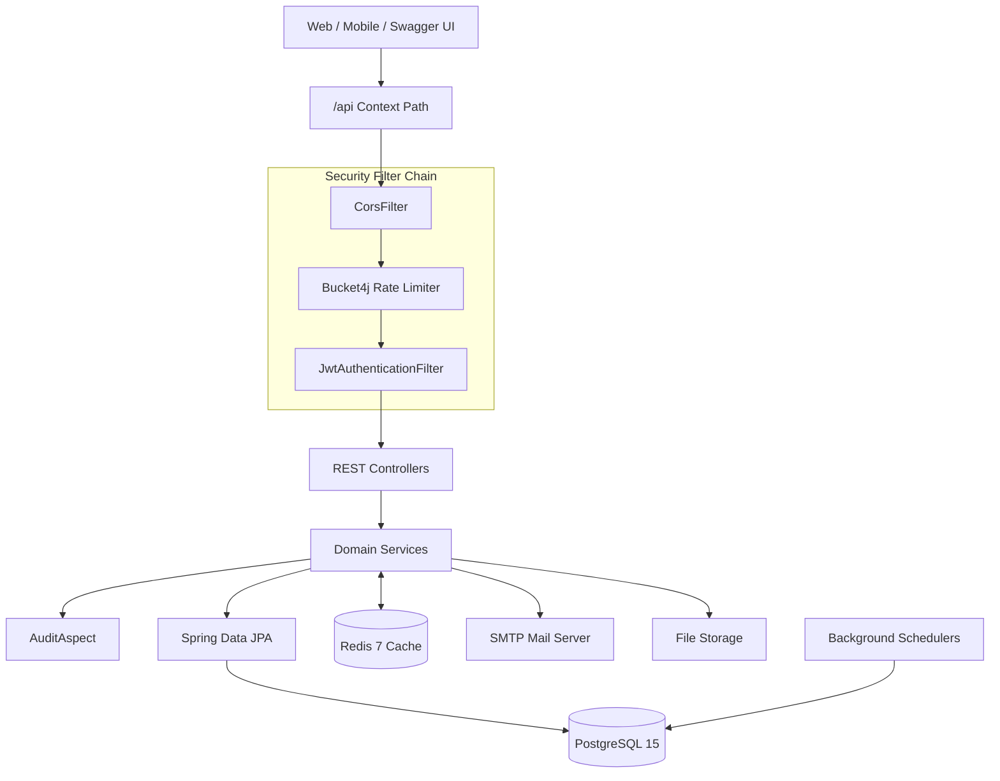
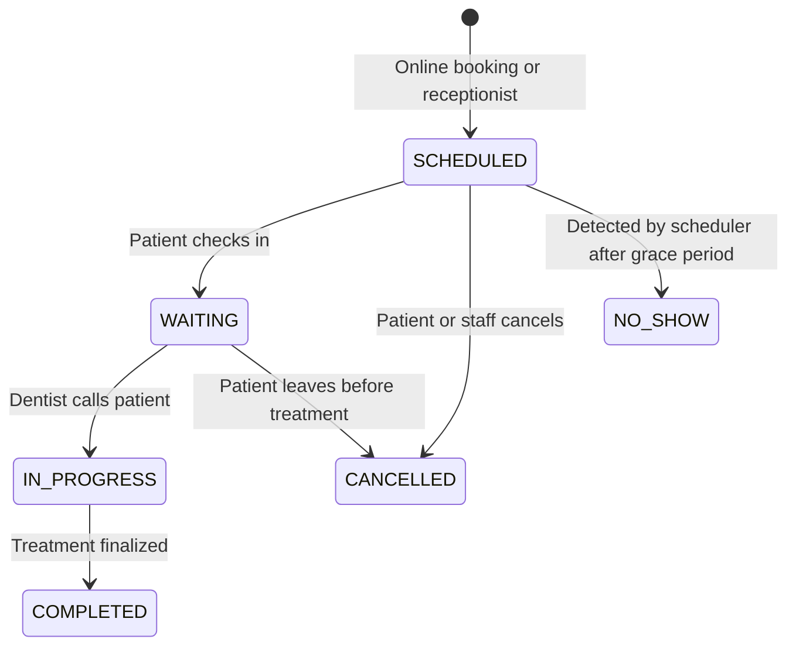
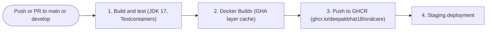

# OralCare

[](https://spring.io/projects/spring-boot)
[](https://openjdk.org/)
[](https://www.postgresql.org/)
[](https://redis.io/)
[](https://flywaydb.org/)
[](https://www.docker.com/)
[](LICENSE)

OralCare is a multi-tenant backend for dental practices and clinic chains. It is built with **Spring Boot 3.2.4**, **Java 17**, **PostgreSQL 15**, **Redis 7**, and **Spring Security 6**. It provides appointment queue management, automated no-show handling, FDI tooth charting (odontograms), billing with partial payments and PDF invoices, and audit logging.

## Table of Contents

1. [Overview](#overview)
2. [Architecture](#architecture)
3. [Technology Stack](#technology-stack)
4. [Core Modules](#core-modules)
5. [Getting Started](#getting-started)
6. [Configuration](#configuration)
7. [Security](#security)
8. [Testing](#testing)
9. [API Reference](#api-reference)
10. [CI/CD and Deployment](#cicd-and-deployment)
11. [Project Roadmap](#project-roadmap)
12. [License](#license)

---

## Overview

Dental clinics commonly face the following problems, which OralCare addresses:

- **Queue congestion and double-booking.** Fixed appointment slots and walk-ins compete for the same practitioner time. OralCare combines scheduled slots with a live first-come-first-served (FCFS) queue and recalculates wait times as visits change.
- **No-shows.** A background job detects lapsed appointments, marks them as `NO_SHOW`, removes the patient from the active queue, and updates waiting times.
- **Non-standard dental records.** Generic EHRs rarely support tooth-level tracking. OralCare uses the FDI two-digit numbering system (teeth 11 to 48) and records each change with the practitioner and date.
- **Billing across multi-visit treatments.** Implants, braces, and root canals are paid in installments. OralCare tracks partial payments, balances, and invoice status, and generates PDF invoices.
- **Tenant isolation.** Each clinic is isolated by `clinic_id` within a shared database, so branches do not need separate database servers. Tenant isolation is one part of a HIPAA-aligned design; full compliance also depends on operational and organizational controls.

---

## Architecture

### Request lifecycle

1. **Routing.** All endpoints are served under `/api`.
2. **Rate limiting.** A Bucket4j token bucket limits each client IP to 10 requests per minute on authentication routes.
3. **Authentication.** `JwtAuthenticationFilter` validates the `Bearer` token and binds the user ID, clinic ID, and roles to the security context and tenant context.
4. **Authorization.** Method-level `@PreAuthorize` rules enforce role-based access control.
5. **Validation.** Jakarta Bean Validation (`@Valid`) rejects malformed input with HTTP 400 and field-level error messages.
6. **Business logic.** Services run inside `@Transactional` boundaries. Reads can be cached with `@Cacheable`, and writes evict stale entries with `@CacheEvict`.
7. **Auditing.** Methods annotated with `@Audit` are logged by `AuditAspect` after they return successfully. Each entry records the user, client IP, action, and entity ID in `audit_logs`.
8. **Response.** Every response uses a common `ApiResponse<T>` envelope containing a timestamp, status code, and payload.

---

## Technology Stack

| Component | Technology | Version | Rationale |
|---|---|---|---|
| Language | OpenJDK | 17 LTS | Long-term support, records, sealed classes, and pattern matching |
| Framework | Spring Boot | 3.2.4 | Jakarta EE 10 namespace, virtual thread support, and Actuator |
| Security | Spring Security, JJWT | 6.x, 0.11.5 | Stateless HMAC-SHA256 access tokens with database-tracked refresh tokens |
| Rate limiting | Bucket4j | 8.7.0 | In-process token bucket for brute-force protection |
| Database | PostgreSQL | 15 (Alpine) | ACID transactions, JSONB, row-level locking, and strict constraints |
| Migrations | Flyway | 9.x | Versioned SQL migrations (V1 to V6) applied at startup |
| Cache | Redis | 7 (Alpine) | Distributed cache for analytics and frequently read data |
| Documents | OpenPDF, Apache POI | 1.3.30, 5.2.5 | PDF invoice generation and Excel export |
| Testing | Testcontainers | 1.20.1 | Disposable PostgreSQL and Redis containers that match production |
| API docs | Springdoc OpenAPI | 2.3.0 | OpenAPI 3 specification and Swagger UI |
| Monitoring | Micrometer, Prometheus | Managed by Spring Boot | JVM, throughput, and error metrics via Actuator |

---

## Core Modules

### Appointments and FCFS queue

**Slot generation.** Available 30-minute consultation windows are computed from dentist availability rules, approved leave, and existing bookings. Overlapping bookings are rejected.

**Estimated wait time.** For a patient at queue position *n*:

```
Estimated wait (minutes) = (n - 1) × 30
```

**Status lifecycle:**



### Background schedulers

| Job | Cron | Responsibilities |
|---|---|---|
| No-show detection | `0 */5 * * * *` (every 5 minutes) | Marks overdue `SCHEDULED` or `CONFIRMED` appointments as `NO_SHOW`, removes them from the queue, recalculates waiting times, and notifies the patient and staff |
| Hourly clinic job | `0 0 * * * *` (every hour) | Sends reminders for appointments 23 to 25 hours away, marks unpaid bills past their due date as `OVERDUE`, and removes expired password reset tokens |

### Odontogram (dental charting)

The chart follows the FDI two-digit numbering system across four quadrants: 11 to 18, 21 to 28, 31 to 38, and 41 to 48.

Supported conditions: `HEALTHY`, `CAVITY`, `CROWN`, `FILLING`, `EXTRACTED`, `IMPLANT`, `ROOT_CANAL`, `VENEER`, and `FRACTURED`.

Each update stores the dentist's user ID, the treatment date, and clinical notes, which creates a history of changes for each tooth.

### Billing and invoices

- **Calculation.** Subtotal, tax, and discount are computed for each bill.
- **Partial payments.** A bill can receive multiple payments. Its status updates automatically:

| Condition | Status |
|---|---|
| Total paid = 0 | `UNPAID` |
| 0 < total paid < total amount | `PARTIALLY_PAID` |
| Total paid ≥ total amount | `PAID` |

- **PDF invoices.** `PdfInvoiceService` generates an itemized invoice with OpenPDF on request.

### Auditing

`AuditAspect` intercepts methods annotated with `@Audit` and writes to `audit_logs` after they succeed. Business services do not need logging code.

---

## Getting Started

### Prerequisites

- JDK 17 (`java -version`)
- Docker and Docker Compose (`docker compose version`)
- Git

### 1. Clone and configure

```bash
git clone https://github.com/deepakbhat18/oralcare.git
cd oralcare
cp .env.example .env
```

Review `.env` and update database or mail settings if needed. The defaults are suitable for local development.

### 2. Start PostgreSQL and Redis

```bash
docker compose up -d postgres redis
```

### 3. Run the application

```bash
./mvnw clean spring-boot:run
```

Once running:

| Resource | URL |
|---|---|
| REST API base | http://localhost:8080/api |
| Swagger UI | http://localhost:8080/api/swagger-ui.html |
| OpenAPI spec | http://localhost:8080/api/v3/api-docs |
| Prometheus metrics | http://localhost:8080/api/actuator/prometheus |
| Health check | http://localhost:8080/api/actuator/health |

### 4. Run everything in Docker

```bash
docker compose up --build -d
```

---

## Configuration

Sensitive values are read from environment variables in `application.yml`. Copy `.env.example` to `.env` and set these values:

| Variable | Purpose |
|---|---|
| `DB_PASS` | PostgreSQL password |
| `JWT_SECRET` | Signing key for JWT access tokens. Use a long random value in every environment. |
| `MAIL_PASS` | SMTP password for OTP and reminder emails |
| `GOOGLE_CLIENT_SECRET` | Google OAuth client secret |

Never commit a real `.env` file. The `.env.example` template is the only environment file tracked by Git.

---

## Security

### Secrets management

- No secrets are hardcoded. All credentials are supplied through environment variables.
- `.gitignore` excludes `.env`, `*.key`, `*.pem`, `*.jks`, `uploads/`, and `postgres_data/`.
- `.dockerignore` keeps secrets and local build artifacts out of Docker images.
- A pre-commit hook can block commits that contain `.env` files, private keys, or credentials. Git hooks are not versioned, so each developer must install the hook locally.

### Authentication and sessions

- Access tokens expire after **24 hours**.
- Refresh tokens expire after **7 days**. Each one is stored in `refresh_tokens` with device metadata (IP address, device details, and last active time), so users can review and revoke individual sessions.
- Accounts are locked for **15 minutes** after **5 consecutive failed login attempts**.
- Authentication routes are rate-limited to **10 requests per minute** per client IP.

### Authorization

Endpoints use `@PreAuthorize` with roles such as `PATIENT`, `DENTIST`, `RECEPTIONIST`, and `ADMIN`. See the [API Reference](#api-reference) for the role required by each endpoint.

---

## Testing

The test suite uses **Testcontainers** instead of H2. H2 does not reproduce PostgreSQL syntax, locking behavior, or Flyway migration details, so tests run against the same engines used in production.

`BaseIntegrationTest` starts:

- `postgres:15-alpine`
- `redis:7-alpine`

### Running tests

```bash
# All unit and integration tests
./mvnw test

# A single test class
./mvnw test -Dtest=BillingIntegrationTest
```

Docker must be running for Testcontainers to start the containers.

### Notable test classes

- `BillingIntegrationTest`: ledger balances and partial payments
- `SmartAnalyticsIntegrationTest`: Redis cache hits and misses, and analytics aggregation
- `SecurityIntegrationTest`: `@PreAuthorize` role enforcement
- `AppointmentQueueManagementTest`: FCFS wait-time calculation and booking collision checks

---

## API Reference

| Method | Endpoint | Access | Description |
|---|---|---|---|
| `POST` | `/api/auth/register` | Public | Register a patient account and send an email OTP |
| `POST` | `/api/auth/login` | Public | Authenticate and receive access and refresh tokens |
| `POST` | `/api/auth/refresh-token` | Public | Rotate the refresh token and issue a new access token |
| `GET` | `/api/dentists/{id}/slots` | Authenticated | List available booking slots for a date |
| `POST` | `/api/appointments/book` | `PATIENT`, `RECEPTIONIST` | Book an appointment, with collision checks |
| `POST` | `/api/appointments/{id}/check-in` | `RECEPTIONIST`, `ADMIN` | Check in a patient and add them to the queue |
| `GET` | `/api/queue/live` | `DENTIST`, `RECEPTIONIST` | View the live queue with estimated wait times |
| `GET` | `/api/patients/{id}/odontogram` | `DENTIST`, `ADMIN` | Retrieve the 32-tooth FDI chart |
| `PUT` | `/api/patients/{id}/odontogram` | `DENTIST` | Update the condition of a tooth |
| `POST` | `/api/bills` | `RECEPTIONIST`, `ADMIN` | Create an invoice with tax and discount |
| `POST` | `/api/bills/{id}/payments` | `RECEPTIONIST`, `ADMIN` | Record a payment and update the bill status |
| `GET` | `/api/bills/{id}/pdf` | Authenticated | Download the invoice as a PDF |
| `GET` | `/api/analytics/dashboard` | `ADMIN` | Revenue and queue metrics (cached in Redis) |

Full request and response schemas are available in Swagger UI at `/api/swagger-ui.html`.

---

## CI/CD and Deployment

The GitHub Actions workflow is defined in `.github/workflows/ci-cd.yml`.



- **Testing.** `./mvnw clean test` runs on every push and pull request against Ubuntu runners with Docker available for Testcontainers.
- **Publishing.** The image is pushed to GitHub Container Registry. The job uses `packages: write` permission.
- **Image tags.** `docker/metadata-action@v5` generates tags and lowercases the repository name.
- **Caching.** Buildx uses GitHub Actions cache (`type=gha`) to speed up image builds.

---

## Project Roadmap

- Patient-facing web and mobile clients
- Online payment gateway integration
- Imaging (X-ray) upload with access controls
- Expanded analytics dashboards

---

## License

This project is licensed under the [MIT License](LICENSE).
