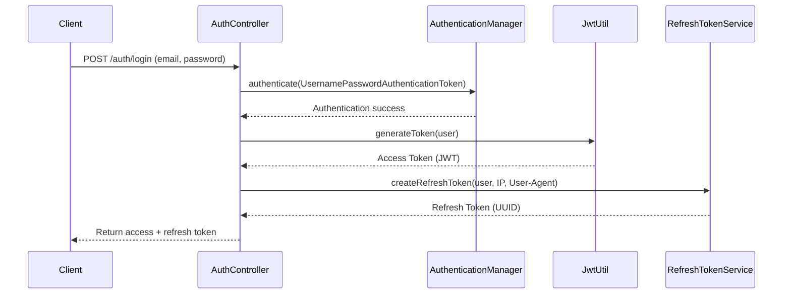

# 01 - Authentication Guide

This document details the security architecture, token models, session tracking, and rotation policies implemented in the OralCare SaaS backend.

---

## 1. Authentication Flow

---

## 2. Refresh Token Rotation (RTR) & Reuse Detection
To prevent refresh token hijacking, the system implements **Refresh Token Rotation (RTR)**:
1. When a client requests a new JWT token using `POST /auth/refresh-token`, the old refresh token is marked as `revoked = true` and saved.
2. A new refresh token (UUID) and a new JWT access token are generated and returned.
3. If an attacker steals a previously used refresh token and attempts to reuse it:
   - The system intercepts the request inside `verifyExpiration()`.
   - Seeing `revoked = true`, the system assumes a replay attack has occurred.
   - It immediately revokes/deletes **all** active refresh tokens belonging to that user, invalidating all sessions across all devices.
   - An HTTP 401 Unauthorized error is thrown, forcing the legitimate user to log in again.

---

## 3. Session Tracking & Multi-Device Management
- Users can maintain up to 5 concurrent active sessions across different browsers and devices.
- Active refresh tokens are stored in the database with metadata: `ip_address`, `device_details`, and `last_active`.
- If a user signs in on a 6th device, the oldest active session is automatically revoked.
- Users can view and revoke selected sessions via `GET /sessions` and `DELETE /sessions/{id}`.
