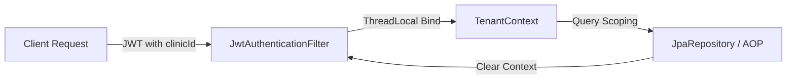

# 02 - Tenant Isolation Guide

This document describes how multi-clinic tenant isolation is enforced at the database, query, and request routing layers in the OralCare SaaS backend.

---

## 1. Request Context Scoping



### 1.1. Context Lifecycle
1. The client sends a request containing a bearer JWT token.
2. The `JwtAuthenticationFilter` intercepts the request and parses the claims.
3. The custom `clinicId` claim is bound to a thread-local variable via `TenantContext.setCurrentTenantId(...)`.
4. During service and repository operations, the tenant context is checked to scope and restrict operations.
5. In a `finally` block of the filter, the thread-local state is cleared to prevent cross-request leakage:
   ```java
   try {
       filterChain.doFilter(request, response);
   } finally {
       TenantContext.clear();
   }
   ```

---

## 2. Database Scoping Validation
- Tables such as `bills`, `prescriptions`, `treatment_plans`, and `treatment_records` contain a foreign key `clinic_id` column.
- Whenever querying or writing records, the service verifies that the entity's `clinicId` matches the caller's bound `TenantContext.getCurrentTenantId()`.
- If a tenant cross-talk attempt is detected (e.g. attempting to fetch a bill from another clinic), a validation exception is thrown.
