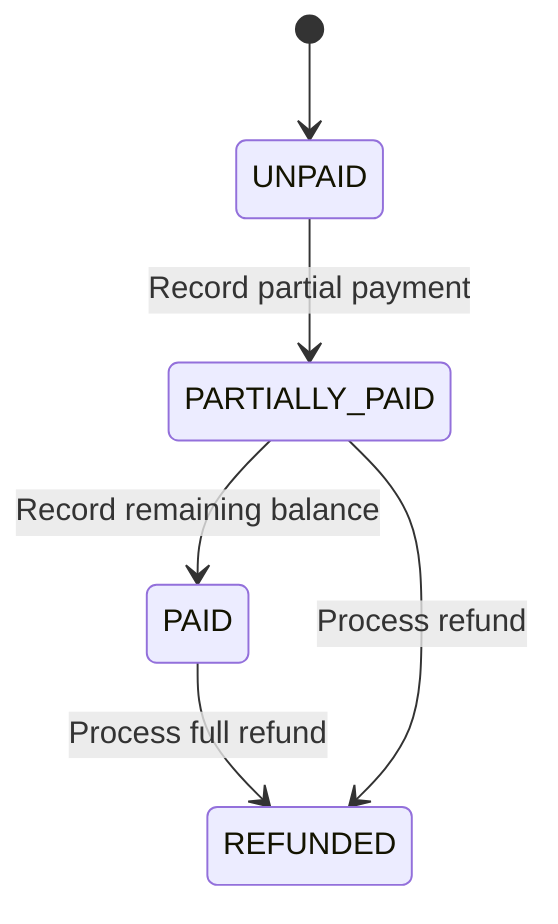

# 03 - Billing & Invoicing Guide

This document maps out the billing ledger system, payment calculations, status transitions, and PDF generation processes.

---

## 1. Billing Ledger & Status Transitions
The status of a `Bill` invoice is dynamically updated as transactions are logged against it:
- **UNPAID**: Initial state. No payments recorded.
- **PARTIALLY_PAID**: The sum of non-refund payments is greater than zero but less than the final invoice amount.
- **PAID**: The sum of non-refund payments meets or exceeds the final invoice amount.
- **REFUNDED**: A refund transaction is processed that brings the net paid amount back to zero or less.

---

## 2. PDF Invoice Generation
The `PdfInvoiceService` uses LibrePDF/OpenPDF to dynamically build A4 invoices containing:
- Clinic metadata header (name, address, contacts).
- Patient information & metadata block.
- Chronological breakdown of procedures and treatment plans.
- Financial details: Subtotal, applied discount, taxes, and final total.
- **Payment History Ledger**: Lists all transaction times, payments, refunds, references, and remaining balances.
