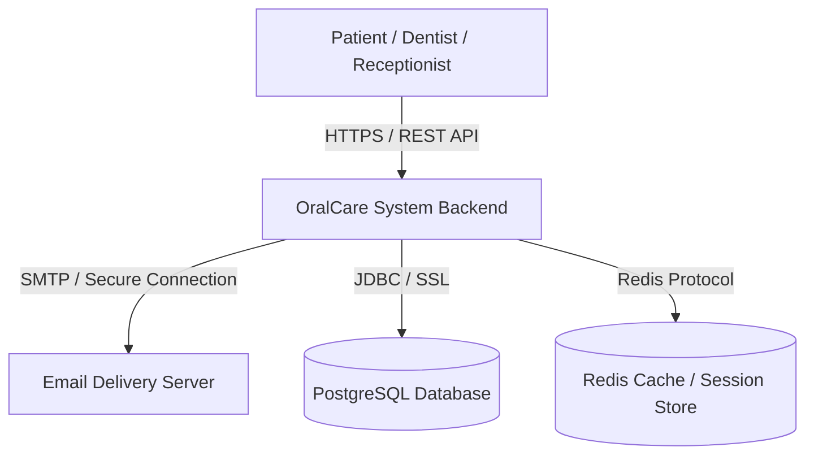
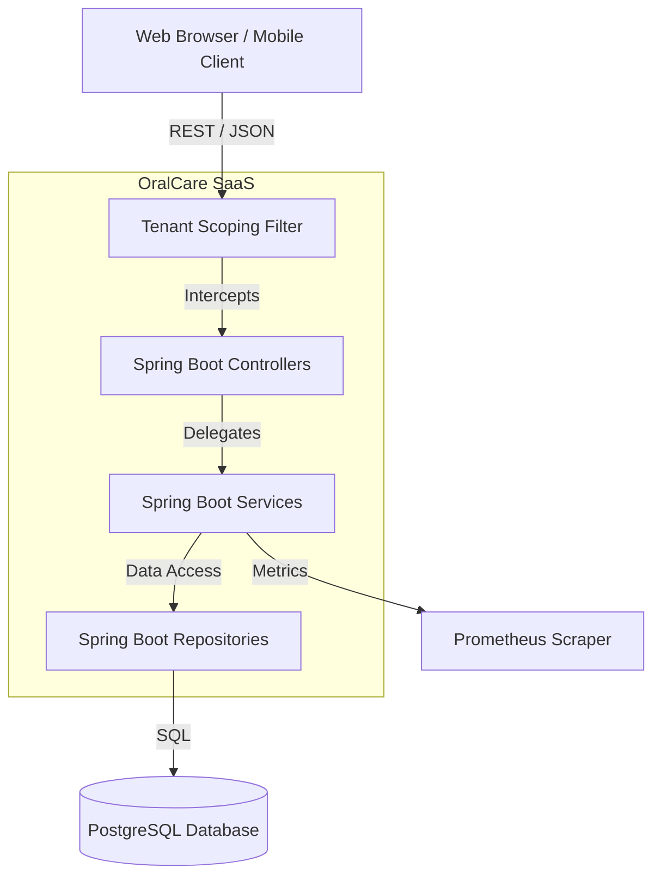

# 08 - C4 Architecture Diagrams

This document details the architectural layout of the OralCare Dental SaaS backend.

---

## 1. System Context Diagram
Shows how the system fits into the dental clinic IT landscape.

---

## 2. Container Diagram
Decomposes the OralCare system into its core containers.

